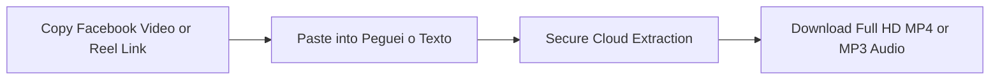
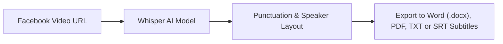

Mastering **how to download Facebook videos** remains one of the most frequent web searches worldwide. Despite the rise of emerging video platforms, **Facebook** still houses an immense repository of long-form and viral content: educational keynotes, live streams from industry experts, cooking masterclasses, nostalgic memes, community panel discussions, and trending short-form **Facebook Reels**.

However, anyone attempting to save a video directly within the official Facebook mobile app or desktop interface runs into a major barrier: **the platform offers no native button to save the raw video file (.mp4) directly to your phone gallery or computer hard drive**. The native "Save video" feature merely bookmarks a cloud shortcut within your Facebook profile for later viewing, requiring an uninterrupted internet connection.

Worse yet, searching for terms like *"download Facebook video"* or *"Facebook video downloader"* on Google leads most users to questionable websites brimming with explicit advertisements, deceptive fake virus alerts, and malware installers.

In this **definitive, updated 2026 guide**, you will discover the complete, secure step-by-step process to **download Facebook videos in pristine high definition (MP4 Full HD)** on mobile (Android and iPhone) and PC/Mac, learn how to handle private group content, and discover how AI can instantly transcribe spoken dialogue from any Facebook video into written text.

---

## The Hidden Hazards of Ad-Heavy Facebook Downloaders (FDown, SnapSave & Clones)

Over the past few years, dozens of popular Facebook video download sites have become economically unsustainable without resorting to aggressive ad networks.

Using these generic downloaders frequently exposes you to significant digital risks:

1. **Notification Hijacking**: The site overlays your screen claiming: *"Click Allow to verify you are human and download your video"*. If granted, your browser gets flooded with persistent deceptive popups (*"Your OS is infected"*) and gambling promotions.
2. **Deceptive Download Buttons**: The page is cluttered with dozens of flashing green and red buttons. Nearly all are ads routing you to invasive browser extension installers.
3. **Severe Quality Downscaling**: Many services promise 1080p Full HD, yet deliver heavily compressed 480p or 360p clips with out-of-sync audio.
4. **Malicious Executable Files (.EXE / .APK)**: Never install executable software suggested by online web converters to save a simple video. If a site demands you run an installer, close the tab immediately.

> **Safety Guideline**: Modern cloud-based media extractors parse public video URLs directly on remote servers without asking for device-level installations or browser permissions.

---

## Method 1: Download Facebook Videos Online with Peguei o Texto (Recommended & Secure)

The cleanest, fastest, and most reliable way to download Facebook videos and Reels in **Full HD MP4** or extract audio in **MP3** is through [Peguei o Texto Video Downloader](/en/download-youtube-video).

The engine handles the link directly on high-speed cloud servers, bypassing third-party ad networks and streaming the clean media file straight to your local storage.



### Step-by-Step Instructions:

1. Open **Facebook** (in the mobile app or desktop browser) and find your desired video or Reel.
2. Click or tap the **Share** button located below the post.
3. Choose **"Copy link"**.
4. Navigate to the [Peguei o Texto Video Downloader](/en/download-youtube-video) page in your browser.
5. Paste the URL into the search field and click **"Search Video"**.
6. The system retrieves the stream details and provides direct buttons: **"Download Video (MP4 HD)"** and **"Download Audio (MP3)"**.
7. Click your preferred format: the file downloads cleanly and directly to your downloads directory!

---

## Method 2: How to Download Facebook Videos & Reels on Mobile (Android & iPhone)

The majority of Facebook video consumption takes place on smartphones. Here is how to save videos straight to your mobile gallery on Android and iOS.

### On Android:
1. Open the Facebook app on your smartphone.
2. On the video or Reel you wish to save, tap the **three dots (...)** icon in the upper-right corner of the post (or tap **Share** at the bottom).
3. Tap **"Copy link"**.
4. Open your browser (**Google Chrome**, **Samsung Internet**, or **Brave**) and visit `pegueiotexto.com.br/en/download-youtube-video`.
5. Paste the link into the search box and confirm.
6. Tap **"Download Video (MP4 HD)"**.
7. The file saves to your device's **Downloads** folder and instantly appears in **Google Photos** or the Android **Gallery**.

### On iPhone and iPad (iOS):
Apple's **Safari** browser includes a built-in download manager:
1. In the Facebook app, tap **Share** > **Copy link**.
2. Open **Safari** and go to [Peguei o Texto](/en/download-youtube-video).
3. Paste the URL and tap **"Download Video (MP4 HD)"**.
4. Safari displays a prompt: *"Do you want to download this file?"* — tap **"Download"**.
5. Tap the download icon (circle with downward arrow) in the address bar.
6. Open the downloaded video, tap the **Share** icon (box with upward arrow), and select **"Save Video"**.
7. The video file is immediately saved to the camera roll in your native iOS **Photos** app!

---

## Method 3: How to Download Facebook Videos on Desktop (Windows & Mac)

If you work as a content creator, social media manager, or researcher, saving raw footage directly on your desktop streamlines editing workflows in Adobe Premiere, DaVinci Resolve, or CapCut Desktop.

### Via Web Browser:
1. On your computer, open [Facebook](https://www.facebook.com) and right-click on the video (or click the three dots on the post).
2. Select **"Copy link at current time"** or **"Copy link"**.
3. Open [Peguei o Texto](/en/download-youtube-video).
4. Paste the link using `Ctrl + V` (Windows) or `Cmd + V` (Mac) and click **"Search Video"**.
5. Click **"Download Video (MP4 HD)"** and select your preferred destination folder on your machine.

### The Classic Browser "mbasic" Trick:
There is an alternative trick that requires no external software by leveraging Facebook's legacy lightweight mobile interface:

1. Open the Facebook video post in your desktop browser.
2. In the URL address bar, change `www` or `web` to `mbasic` (e.g., from `https://www.facebook.com/...` to `https://mbasic.facebook.com/...`).
3. Press `Enter`. Facebook will render in its minimalist early-2000s HTML layout.
4. Click play on the video. It will launch in an isolated new browser tab using the browser's native HTML5 media player.
5. Right-click anywhere on the playback screen and choose **"Save video as..."**.

*Note: While handy in an emergency, this trick typically downloads standard definition (SD 360p/480p) streams, whereas dedicated tools deliver maximum Full HD resolution.*

---

## Method 4: How to Download Videos from Private Facebook Groups

A frequent challenge is saving videos posted inside **private, closed, or secret Facebook groups** in which you are a registered member.

### Why do standard online downloaders fail on private videos?
Online tools require public access to read the video streams on Meta's content delivery network. Because private group posts require user authentication and membership permissions, public scrapers encounter an authorization block and report *"Video not found or private"*.

### Safe procedure for member-accessible private videos:
To safely save a restricted video you have legitimate authorization to access:

1. Open the private video post in your desktop browser.
2. Press `Ctrl + U` on Windows (or `Cmd + Option + U` on Mac) to view the **Page Source** (`view-source:`).
3. Press `Ctrl + F` (Find) and search for `"hd_src":` or `"sd_src":`.
4. You will locate a long URL enclosed in quotes beginning with `https://video...`.
5. Copy that URL, paste it into a new browser tab, and right-click to save the MP4 video.

> **Critical Security Alert**: Never enter your personal Facebook credentials or access tokens into third-party websites or browser plugins promising "1-click private downloads". This is a notorious phishing technique used to hijack social media profiles and ad accounts.

---

## Method 5: yt-dlp via Terminal (Open-Source Power for Advanced Users)

For developers, data analysts, and tech-savvy archivists, **yt-dlp** provides unmatched open-source capabilities for media downloading:

```bash
# Download Facebook video in highest available resolution
yt-dlp -f "bestvideo+bestaudio/best" "https://www.facebook.com/watch/?v=123456789"
```

*yt-dlp* is maintained actively on GitHub, contains no advertisements, and supports automation scripts. For everyday tasks, however, using Peguei o Texto's clean browser interface delivers the same high-resolution files without command-line overhead.

---

## Comparison Table: Best Ways to Download Facebook Videos in 2026

| Method | Max Resolution | Virus-Free & Safe? | No Adware/Popups? | Extract MP3 Audio? | Transcribe with AI? |
| :--- | :--- | :--- | :--- | :--- | :--- |
| 🚀 **[Peguei o Texto](/en/download-youtube-video)** | **1080p Full HD** | **Yes (100% Secure)** | **Yes (Zero Popups)** | **Yes (1-Click)** | **Yes (Whisper AI)** |
| 🌐 **Ad-Heavy Downloaders** | Inconsistent (360p-720p) | High Malware Risk | No (Intrusive Ads) | Limited | No |
| 🕹️ **mbasic Browser Trick** | 360p / 480p (SD) | Safe (Native) | Yes | No | No |
| 💻 **yt-dlp (CLI)** | Native Full HD | Safe (Open Source) | Yes | Yes (via FFmpeg) | No |

---

## Supercharge Content with AI: Transcribe Spoken Dialogue into Text

Often, saving the raw video file is merely a means to an end. What you genuinely need is the **spoken intelligence within the video**:

* Executive summaries from webinars or keynote addresses streamed on Facebook Watch;
* Client testimonials to include in case studies;
* Creator scripts from viral Facebook Reels to study storytelling hooks and retention;
* Timed subtitle files to repurpose clips across TikTok and YouTube Shorts.

Instead of spending hours manually scrubbing through videos and typing transcripts by hand, use Peguei o Texto's **AI Transcription Engine**:



Powered by OpenAI's **Whisper** model, the engine generates organized paragraphs, applies accurate punctuation, and lets you export ready-to-use documents in **Word (.docx)**, **PDF**, or synchronized **.SRT** subtitles.

*(Be sure to read our companion guides on [how to transcribe video to text online](/en/blog/transcribe-video-to-text-online-free) and [how to generate SRT subtitles](/en/blog/how-to-generate-srt-subtitles)).*

---

## Frequently Asked Questions (FAQ)

### 1. Is it safe to download Facebook videos on my phone?
Yes, as long as you use trusted web-based tools that do not require installing unknown `.apk` packages on Android or custom device profiles on iOS. [Peguei o Texto](/en/download-youtube-video) operates entirely in your browser without requesting access to your private device files.

### 2. Why do some Facebook videos download in lower resolution (SD)?
Facebook employs adaptive DASH streaming, separating audio and video streams at high resolutions to conserve mobile bandwidth. Basic web tools only extract the low-resolution progressive fallback. Peguei o Texto stitches high-definition video and audio together to provide Full HD whenever available.

### 3. How do I download Facebook Reels without watermarks?
Simply copy the Reel link within the Facebook app (**Share** > **Copy link**), paste it into [Peguei o Texto](/en/download-youtube-video), and click download. Facebook Reels do not contain bouncing on-screen watermarks like TikTok.

### 4. Can I extract only the background music or audio in MP3?
Yes! When you paste the Facebook video URL into Peguei o Texto, select **"Download Audio (MP3)"**. The system extracts the pure audio track in high acoustic fidelity.

---

## Conclusion

Downloading Facebook videos does not need to involve shady websites or cybersecurity hazards. Using modern solutions like [Peguei o Texto](/en/download-youtube-video), you can save your favorite videos in Full HD MP4 and extract crystal-clear MP3 audio in seconds.

And when you need to transcribe, study, or summarize speech from interviews or live streams, take advantage of built-in Artificial Intelligence to convert audio into structured text documents effortlessly.
