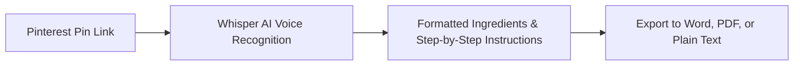

Learning **how to download Pinterest videos** is one of the fastest-growing searches among designers, culinary lovers, DIY crafters, fashion stylists, and content creators. **Pinterest** has evolved into the world's most vibrant visual inspiration catalog: hosting millions of short cooking recipes, step-by-step DIY renovations, fitness workouts, skincare routines, aesthetic 3D loops, and trending clips.

However, anyone attempting to save these videos directly inside the official Pinterest app encounters an annoying hurdle: while static photos offer a native "Download image" button, **videos only feature a "Save to board" option**. This merely bookmarks the pin within your cloud profile, keeping the raw video file (.mp4) out of your phone's camera roll or computer hard drive and making offline viewing or video editing impossible.

Worse yet, searching the web for *"download Pinterest video"* typically leads to a double disappointment:
1. **Muted videos (no sound)**: The overwhelming majority of online tools export videos without their original audio track.
2. **Aggressive adware**: Sketchy sites loaded with fake virus warnings, deceptive buttons, and intrusive browser prompts.

In this **definitive 2026 guide**, you will discover the secure step-by-step method to **download Pinterest videos with full audio in 1080p Full HD MP4**, learn how to save pins on mobile (Android and iPhone) and desktop, and see how AI can instantly transcribe spoken recipe ingredients or DIY instructions into written notes.

---

## The Big Mystery: Why Do Generic Downloaders Deliver Muted Pinterest Videos?

If you have previously tried generic online Pinterest downloaders, you have likely opened the downloaded video in your phone gallery only to discover that **the sound track completely vanished**.

### The Technical Reason:
Pinterest uses **HLS (HTTP Live Streaming)** to optimize bandwidth and deliver smooth endless scrolling. To achieve this, Pinterest servers split media into two separate feeds:
* An isolated **video stream** (served as `.ts` segments or an audio-free `.mp4` file);
* An isolated **audio stream** (compressed separately as `.m4a`).

Legacy web converters simply scrape the first video URL they find on the page, completely omitting the separate audio stream.

> **The Peguei o Texto Advantage**: The cloud processing engine behind [Peguei o Texto Video Downloader](/en/download-youtube-video) automatically detects both independent media feeds, performs lossless server-side multiplexing, and delivers a **Full HD MP4 file with perfectly synchronized, crystal-clear stereo audio**.

---

## Hazards of Generic Ad-Laden Pinterest Converters

When looking for tools to download pins, users often land on dated portals using aggressive monetization:

1. **Deceptive Notification Hijacking**: Full-page prompts insisting: *"Click Allow to verify you are human and proceed to download"*. Granting permission bombards your system with deceptive scam popups.
2. **Misleading Download Buttons**: Giant flashing green or red buttons reading *"Start Download"*. Nearly all are ads routing users to sketchy subscription pages or toolbars.
3. **Questionable Chrome Extensions**: Services forcing you to install third-party browser extensions to "unlock HD quality," potentially compromising personal browser data.

---

## Method 1: Download Pinterest Videos with Audio on Peguei o Texto (Recommended & Free)

The fastest, cleanest, and safest way to download Pinterest videos in **Full HD MP4 with audio** or extract audio in **MP3** is with [Peguei o Texto](/en/download-youtube-video).

The utility is 100% free, requires no user account, and natively resolves both short mobile links (`pin.it`) and desktop URLs (`pinterest.com/pin/...`).


### Step-by-Step Instructions:
1. Open the **Pinterest** app on your phone or visit the website on your computer.
2. Navigate to the video Pin you wish to save.
3. Click or tap the **Share** button and choose **"Copy link"**.
4. Visit the [Peguei o Texto Video Downloader](/en/download-youtube-video) page in your browser.
5. Paste the URL into the search bar and click **"Search Video"**.
6. The engine parses the Pin instantly and surfaces two options: **"Download Video (MP4 HD)"** (with full audio) and **"Download Audio (MP3)"**.
7. Click your preferred format: the file downloads directly to your device without popups or redirects!

---

## Method 2: How to Download Pinterest Videos on Mobile (Android & iPhone)

Over 80% of Pinterest users browse on smartphones. Follow these instructions for your operating system:

### On Android:
1. In the Pinterest app, open the desired video.
2. Tap the **three dots (...)** icon in the upper-right corner of the Pin (or tap the **Share** icon) and select **"Copy link"**.
3. Open your mobile browser (**Google Chrome** or **Samsung Internet**) and go to `pegueiotexto.com.br/en/download-youtube-video`.
4. Paste the Pin link and tap **"Search Video"**.
5. Tap **"Download Video (MP4 HD)"**.
6. The file downloads directly to your **Downloads** folder and instantly appears in your **Gallery** or **Google Photos**.

### On iPhone and iPad (iOS):
On iOS devices, **Safari** provides a native and private download manager:
1. In the Pinterest app, tap the **Share** button on the Pin and select **"Copy link"**.
2. Open **Safari** and head to [Peguei o Texto](/en/download-youtube-video).
3. Paste the link into the search input and tap **"Download Video (MP4 HD)"**.
4. Safari shows a prompt: *"Do you want to download this file?"* — tap **"Download"**.
5. Tap the download icon in Safari's address bar, select the downloaded video, tap the **Share** button (box with upward arrow), and choose **"Save Video"**.
6. The video file with crystal-clear audio is now stored directly in your native **Photos** camera roll!

---

## Method 3: How to Download Pinterest Videos on Desktop (Windows & Mac)

For digital designers, video editors, and creators using editing software like Premiere Pro, Canva, or CapCut Desktop:

1. Open [Pinterest](https://www.pinterest.com) in your desktop browser.
2. Click on the video Pin to open its dedicated view.
3. Copy the URL from your browser address bar (e.g., `https://www.pinterest.com/pin/123456789...`) or click the Pin's share button and select **"Copy link"**.
4. Open the [Peguei o Texto Downloader](/en/download-youtube-video).
5. Paste the link (`Ctrl + V` on Windows or `Cmd + V` on Mac) and click **"Search Video"**.
6. Click **"Download Video (MP4 HD)"** to save the media in pristine quality to your preferred folder.

---

## Method 4: How to Download Pinterest GIFs and Animations

Pinterest features an endless selection of animated GIFs for creative inspiration and presentations.

### How GIF extraction works:
Like most modern platforms, Pinterest converts bandwidth-heavy `.gif` files into lightweight MP4 video loops.

When you paste a Pinterest GIF link into [Peguei o Texto](/en/download-youtube-video), the engine automatically detects the media and allows you to download it as an optimized MP4 video. If you specifically need the legacy `.gif` format, you can convert the downloaded MP4 using any online converter.

---

## Method 5: yt-dlp for Pinterest (Open-Source Terminal Tool)

For developers and power users, the open-source CLI utility **yt-dlp** supports Pinterest video extraction with automatic audio multiplexing via FFmpeg:

```bash
# Download Pinterest video with merged audio and video in MP4
yt-dlp -f "bestvideo+bestaudio/best" --merge-output-format mp4 "https://www.pinterest.com/pin/123456789/"
```

yt-dlp resolves both direct pin URLs and short `pin.it` redirects. For daily convenience without terminal commands, Peguei o Texto's clean web interface provides identical output in two clicks.

---

## Comparison Table: Best Ways to Download Pinterest Videos in 2026

| Method / Tool | Max Resolution | Downloads with Audio? | No Intrusive Popups? | Supports pin.it Links? | Extract MP3 Audio? | Transcribe with AI? |
| :--- | :--- | :--- | :--- | :--- | :--- | :--- |
| 🚀 **[Peguei o Texto](/en/download-youtube-video)** | **1080p Full HD** | **Yes (100% Synced)** | **Yes (Zero Ads)** | **Yes** | **Yes (1-Click)** | **Yes (Whisper AI)** |
| 📱 **Official Pinterest App** | Does not save MP4 | Stream online only | Yes | Yes | No | No |
| 🌐 **Ad-Heavy Downloaders** | 480p / 720p | No (Usually Muted) | No (Multiple Popups) | Partial | Limited | No |
| 💻 **yt-dlp (Terminal)** | Native Full HD | Yes (Requires FFmpeg) | Yes | Yes | Yes | No |

---

## Supercharge Pins with AI: Transcribe Recipes & DIY Guides into Text

Saving the video Pin is great for visual inspiration, but what happens when the Pin is a **quick cooking recipe** or a **multi-step DIY woodworking guide**?

You have likely experienced the frustration of:
* Pausing the video every three seconds with flour-covered hands to write down ingredient quantities;
* Rewinding ten times to catch a product name mentioned in passing;
* Trying to manually scribble spoken instructions into a notebook.

Instead of manual note-taking, utilize Peguei o Texto's [AI Video Transcription](/en/transcribe-youtube) tool:



Artificial Intelligence analyzes all spoken dialogue and voiceovers, formats sentences with correct punctuation, and organizes the steps into clear paragraphs. You can copy the recipe directly into your digital notes or export it as a formatted **Word (.docx)** or **PDF** document!

---

## Frequently Asked Questions (FAQ)

### 1. Why do Pinterest videos often download without sound on other websites?
Pinterest separates video and audio into distinct technical streams to save mobile data. Most ad-supported downloaders only grab the video track. [Peguei o Texto](/en/download-youtube-video) merges and synchronizes both streams in the cloud, giving you Full HD video with crystal-clear audio.

### 2. Does the tool support short `pin.it` links?
Yes! Peguei o Texto seamlessly resolves both short mobile URLs (`https://pin.it/...`) and full desktop links (`https://www.pinterest.com/pin/...`).

### 3. Where does the downloaded video save on my phone?
On Android, the file saves directly to your **Downloads** folder and appears in your **Gallery** or **Google Photos**. On iPhone (iOS), tap the share icon in Safari's download menu and select *"Save Video"* to store it in your native **Photos** app.

### 4. Can I extract just the background audio in MP3?
Yes! When you paste the link into Peguei o Texto, simply select **"Download Audio (MP3)"** to extract high-fidelity audio without needing the full video.

---

## Conclusion

Downloading Pinterest videos should not be a frustrating experience filled with muted files, broken links, and deceptive ads. With modern tools like [Peguei o Texto](/en/download-youtube-video), you can save your favorite recipes, DIY guides, and aesthetic inspiration in Full HD MP4 with synchronized audio in seconds.

And whenever you need to turn spoken tutorials into handy written guides, let Artificial Intelligence transcribe the content instantly!

