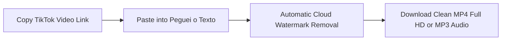
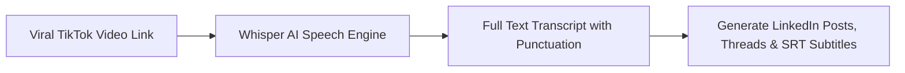

The term **"download TikTok video without watermark"** is one of the highest-volume search queries among digital creators, media buyers, social video editors, and everyday users. With over a billion active users worldwide, **TikTok** is the world's premier trend incubator: hosting everything from quick tutorials and food recipes to viral memes and thought-provoking podcast clips.

However, anyone trying to save a video using the official app's native download button hits an immediate frustration: **the bouncing TikTok watermark**. Besides obscuring important on-screen graphics, this logo severely harms reach whenever you attempt to repurpose the clip onto **Instagram Reels**, **YouTube Shorts**, or **Facebook**.

In this **definitive, updated 2026 guide**, you will learn the safe step-by-step process to **download TikTok videos without watermarks in 1080p Full HD MP4**, understand why reposting with watermarks damages algorithmic distribution, and discover how top content creators use Artificial Intelligence to extract viral video scripts and subtitles in seconds.

---

## The Watermark Dilemma: Why You Should Never Repost with Platform Logos

When you tap "Save video" inside the official TikTok app, the platform stamps an animated watermark showing the platform logo and `@username`, which bounces between the top-left and bottom-right corners of the frame.

While this serves to advertise the app, for creators and brands it represents a **major algorithmic penalty**:

1. **Algorithmic Downranking by Meta (Instagram & Facebook)**: In official creator documentation, Instagram engineers confirmed that the Reels algorithm **automatically detects competing watermarks** and actively suppresses the video from the Explore tab and recommendation feeds.
2. **Penalization on YouTube Shorts**: YouTube prioritizes clean, native vertical video. Clips featuring third-party watermarks receive significantly less algorithmic reach during audience testing.
3. **Unprofessional Brand Appearance**: Videos reposted with third-party watermarks look unpolished and obscure critical subtitles or on-screen captions.

> **Content Repurposing Rule of Thumb**: If you film short-form videos on TikTok, always save a clean copy **without watermarks** so you can cross-post with maximum reach to Instagram Reels, YouTube Shorts, Pinterest, and LinkedIn.

---

## Hidden Dangers of Rogue Online Downloaders (SnapTik, SSSTik & Clones)

Searching for "TikTok video download without watermark" on search engines often leads to dozens of ad-heavy clone portals:

* **Deceptive Permission Prompts**: Overlays demanding: *"Click Allow to download your video"*, which grants the site permission to send spam notifications and deceptive virus alerts.
* **Misleading Download Buttons**: Multi-colored *"Download Now"* banners that actually download suspicious browser toolbars or adware.
* **Heavy Compression**: Low-budget tools that downgrade high-definition 1080p video into pixelated 480p clips with muted colors.

To protect your personal data, always use reputable browser-based cloud extractors that require no `.apk` downloads or invasive software installations.

---

## Method 1: Download TikTok Videos Without Watermark on Peguei o Texto (Recommended)

The cleanest, fastest, and safest way to download watermark-free TikTok videos in **Full HD MP4** or extract audio in **MP3** is through [Peguei o Texto TikTok Downloader](/en/download-tiktok-video).

Engineered with direct cloud-processing technology (no third-party ad networks), the platform preserves 100% of the original video bitrate and delivers the clean file in a single click.

### Simple Step-by-Step Instructions:
1. Open the **TikTok** app on your phone (or visit the website on desktop).
2. On the video you wish to save, tap the **Share** icon (arrow or WhatsApp icon on the right sidebar).
3. Select **"Copy link"**.
4. Open the [TikTok Downloader](/en/download-tiktok-video) page in your browser.
5. Paste the URL into the search box and click **"Search Video"**.
6. The engine previews the clip with options: **"Download Video (MP4 HD)"** (watermark-free) and **"Download Audio (MP3)"**.
7. The file downloads directly to your device!

---

## Method 2: How to Download TikTok Videos on Mobile (Android & iPhone)

### On Android:
1. Copy the video URL inside the TikTok app.
2. Open **Chrome** or **Brave** and navigate to `pegueiotexto.com.br/en/download-tiktok-video`.
3. Paste the URL and tap **"Download Video (MP4 HD)"**.
4. The file downloads to your **Downloads** folder and automatically appears in your **Gallery** or **Google Photos**, ready for editing in CapCut or reposting to Instagram Reels.

### On iPhone & iPad (iOS):
On iOS devices, **Safari** provides a native and private download manager:
1. Open TikTok, tap **Share** > **Copy link**.
2. Open **Safari** and go to [Peguei o Texto TikTok Downloader](/en/download-tiktok-video).
3. Paste the URL and tap **"Download Video (MP4 HD)"**.
4. Safari shows a prompt: *"Do you want to download this file?"* — tap **"Download"**.
5. Tap the download icon in Safari's address bar, open the video, tap the **Share** button (box with upward arrow), and select **"Save Video"**.
6. The clean video is immediately saved to your native iOS **Photos** camera roll!

---

## Method 3: How to Download TikTok Videos on Desktop (PC & Mac)

For video editors, social media strategists, and performance marketers working in Premiere Pro, DaVinci Resolve, or CapCut Desktop:

1. Open [TikTok](https://www.tiktok.com) in your desktop browser.
2. Navigate to the video and copy the URL from the browser address bar (e.g., `https://www.tiktok.com/@creator/video/123456789...`) or click the share button.
3. Open [Peguei o Texto TikTok Downloader](/en/download-tiktok-video).
4. Paste the URL and click **"Search Video"**.
5. Click **"Download Video (MP4 HD)"** to save the clean `.mp4` file directly to your desktop at maximum bandwidth.

---

## Method 4: Download Only TikTok Audio as MP3

Often, your goal when downloading a TikTok video is not the footage itself, but the **trending background sound**, voiceover narration, or sound effect to repurpose in your own editing project.

On [Peguei o Texto](/en/download-tiktok-video), simply paste the video link and click **"Download Audio (MP3)"**. The system extracts the pure audio track, allowing you to save it as an independent sound file.

*(If you also enjoy saving music and podcasts, check our comprehensive guide on [how to download music from YouTube to MP3](/en/blog/download-youtube-music-mp3)).*

---

## Creator Superpower: Transcribe TikTok Scripts with AI

Saving the video file is only the beginning. Elite creators and marketers who generate millions of views understand that the true secret of viral content lies in its **script structure**:

* **The Hook**: What exact words were spoken in the first 3 seconds to stop the scroll?
* **Pacing & Retention**: How did the storyteller structure tension up to the climax?
* **The Call to Action (CTA)**: How did they prompt comments and shares?

Instead of spending hours repeatedly pausing the video to manually scribble down what was said, use Peguei o Texto's [Transcribe TikTok Video](/en/transcribe-tiktok) tool:

### Advantages of AI Transcription for TikTok:
1. **Full Script in 10 Seconds**: Receive all spoken dialogue formatted into clean, punctuated paragraphs.
2. **Cross-Platform Repurposing**: Convert a spoken TikTok video into a Twitter/X thread, a newsletter, or an educational carousel.
3. **Export `.SRT` Subtitle Files**: When editing cutdowns in CapCut, export synced subtitle files in `.srt` (see our guide on [how to generate SRT subtitles](/en/blog/how-to-generate-srt-subtitles)).

---

## Comparison Table: Best Tools to Download TikTok Videos

| Tool | No Watermark? | Max Resolution | Intrusive Ads? | Extract MP3 Audio? | Transcribe with AI? |
| :--- | :--- | :--- | :--- | :--- | :--- |
| 🚀 **[Peguei o Texto](/en/download-tiktok-video)** | **Yes (100% Clean)** | **1080p Full HD** | **No (Zero Ads)** | **Yes (1-Click)** | **Yes (Whisper AI)** |
| 📱 **Official TikTok App** | No (Includes Logo) | Native HD | No | No | No |
| 🌐 **SnapTik / SSSTik Clones** | Yes | Usually 720p | Yes (Heavy Ads) | Limited | No |
| 🤖 **Telegram Bots** | Yes | Variable | Privacy Concerns | Yes | No |

---

## Frequently Asked Questions (FAQ)

### 1. Does downloading TikTok videos without watermark lower video quality?
No. Modern tools like [Peguei o Texto](/en/download-tiktok-video) access the raw video stream stored on TikTok's distribution servers before the watermark overlay is burned in, delivering the identical resolution and sharpness of the original recording.

### 2. Does the tool support short `vm.tiktok.com` and `vt.tiktok.com` links?
Yes! The system automatically resolves short mobile share URLs generated by the app, identifying the canonical video without errors.

### 3. Can I download videos from private TikTok accounts?
No. For privacy and security reasons, no tool can or should access media posted by private accounts that require approved follower permissions.

### 4. Do I need to install any app or browser extension?
No. [Peguei o Texto](/en/download-tiktok-video) runs 100% in your web browser (Chrome, Safari, Edge, Firefox), preserving device storage with no suspicious software downloads.

---

## Conclusion: Download Clean TikTok Videos and Maximize Your Reach

Downloading TikTok videos without watermarks does not need to involve shady websites or security concerns. With fast, modern tools like [Peguei o Texto](/en/download-tiktok-video), you can save your favorite videos in Full HD MP4 and extract audio in MP3 with complete peace of mind.

And if your goal is to grow across social channels with engaging content, take your strategy to the next level: turn viral videos into **structured scripts and captions using Artificial Intelligence**.

Try [Peguei o Texto TikTok Transcriber](/en/transcribe-tiktok) today and transform video into text in seconds!

