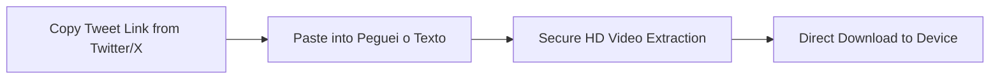
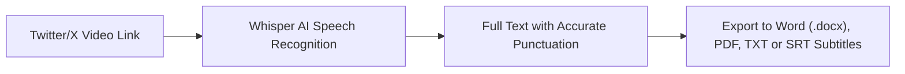

Learning **how to download Twitter (X) videos** is one of the most vital skills for internet users today. Twitter/X serves as the pulse of breaking news worldwide: where trending moments originate, viral memes emerge in hours, controversial press conferences occur, and expert discussions unfold.

Yet everyday users constantly face a common frustration: **Twitter/X has no built-in button to download video files (.mp4) directly to your mobile phone gallery or computer hard drive**. The native "Bookmark" feature merely creates an in-app shortcut that relies on a live internet connection and vanishes completely if the tweet author removes the post or their account gets suspended.

Furthermore, typing *"download Twitter video"* or *"Twitter video downloader"* into search engines frequently leads to websites packed with intrusive ads, deceptive virus alert popups, and malware installers.

In this **definitive, updated 2026 guide**, you will discover the secure step-by-step process to **download Twitter videos in Full HD MP4**, learn how to save animated GIFs as clean video files, and find out how AI can transcribe spoken dialogue from any X video into written text within seconds.

---

## The Transition Challenge: Twitter.com vs. X.com URLs

Following the rebranding of Twitter to **X**, tweet link formats underwent technical changes:

* Classic links: `https://twitter.com/username/status/123456789...`
* Modern links: `https://x.com/username/status/123456789...`

Many older downloaders stopped functioning properly or encounter continuous network errors because their regex parsers were never updated for `x.com` domains.

> **Universal Compatibility**: Modern cloud extractors like **Peguei o Texto** automatically identify and resolve all URL variations (`twitter.com`, `x.com`, or shortened `t.co` redirects), ensuring uninterrupted downloads.

---

## Hidden Dangers of Legacy Ad-Laden Twitter Converters

Searching for Twitter downloaders often lands users on outdated or cloned portals:

1. **Browser Notification Hijacking**: Full-screen prompts demanding you click *"Allow"* to unlock the video download. Granting permission leads to dozens of deceptive notifications claiming your device is compromised.
2. **Deceptive Download Buttons**: Vibrant green and red *"Download Now"* banners that route you to gambling sites or phishing forms instead of delivering your MP4.
3. **Invasive Browser Addons**: Services prompting you to install Chrome extensions that secretly monitor search habits and inject ads into other websites.
4. **Heavy Resolution Downscaling**: To cut hosting expenses, older downloaders often downgrade 1080p source clips to pixelated 360p or 480p versions.

---

## Method 1: Download Twitter (X) Videos Online on Peguei o Texto (Recommended & Secure)

The cleanest, fastest, and most secure way to download Twitter/X videos in **Full HD MP4** or extract audio in **MP3** is through [Peguei o Texto](/en/download-youtube-video).

The platform parses the link directly on high-capacity cloud servers, completely isolating you from malicious third-party scripts.



### How to use the online downloader:
1. Open **Twitter/X** in your app or web browser.
2. On the tweet with the video, tap or click the **Share** button.
3. Select **"Copy link"** (supports both `x.com` and `twitter.com`).
4. Navigate to the [Peguei o Texto Downloader](/en/download-youtube-video) page in your browser.
5. Paste the link into the search box and click **"Search Video"**.
6. The engine parses the media in seconds and displays two buttons: **"Download Video (MP4 HD)"** and **"Download Audio (MP3)"**.
7. Click your desired format: the file downloads cleanly and directly to your downloads directory!

---

## Method 2: How to Download Twitter Videos on Mobile (Android & iPhone)

### On Android:
1. Open the Twitter/X app on your phone.
2. Tap the **Share** button below the video tweet and select **"Copy link"**.
3. Open your mobile browser (**Chrome**, **Samsung Internet**, or **Brave**) and visit `pegueiotexto.com.br/en/download-youtube-video`.
4. Paste the URL and confirm.
5. Tap **"Download Video (MP4 HD)"**.
6. The video downloads to your **Downloads** folder and instantly shows in **Google Photos** or the Android **Gallery**, ready for WhatsApp or Instagram sharing.

### On iPhone and iPad (iOS):
On iOS devices, **Safari** features a native, private download manager:
1. In the X app, tap the **Share** icon on the tweet and select **"Copy link"**.
2. Open **Safari** and go to [Peguei o Texto](/en/download-youtube-video).
3. Paste the URL and tap **"Download Video (MP4 HD)"**.
4. Safari prompts: *"Do you want to download this file?"* — tap **"Download"**.
5. Tap the blue download arrow in the address bar, open the downloaded clip, tap the **Share** icon, and select **"Save Video"**.
6. The Full HD video is immediately stored in your native iOS **Photos** camera roll!

---

## Method 3: How to Download Twitter Videos on Desktop (Windows & Mac)

For journalists, social media managers, and researchers working on desktop:

1. Open [X (Twitter)](https://x.com) in your browser.
2. On the video tweet, click the **Share** button and select **"Copy link to post"** (or copy the URL straight from the browser address bar).
3. Open [Peguei o Texto](/en/download-youtube-video).
4. Paste the link (`Ctrl + V` on Windows or `Cmd + V` on Mac) and click **"Search Video"**.
5. Click **"Download Video (MP4 HD)"** and pick your destination folder.

---

## Method 4: How to Download Twitter GIFs as MP4 Videos

A common inquiry among Twitter users is: *"Why do downloaded Twitter GIFs save as MP4 video files?"*

### The Technical Truth About Twitter GIFs:
Traditional `.gif` format files are legacy 1980s formats that consume ten times more bandwidth than modern video compression. To speed up timeline loading and minimize data usage, **Twitter automatically converts all uploaded GIFs into silent looping MP4 video files**.

When using [Peguei o Texto](/en/download-youtube-video):
1. Copy the tweet link containing the animated GIF.
2. Paste it into the search box.
3. The engine detects the looping media and lets you save the lightweight `.mp4` file in top visual quality.
4. If you specifically require a `.gif` file for PowerPoint slides or sticker packs, you can convert the MP4 using any online converter.

---

## Method 5: yt-dlp for Twitter/X (Open-Source Terminal Tool)

For developers and command-line enthusiasts, **yt-dlp** is the premier open-source tool for downloading Twitter/X media:

```bash
# Download Twitter/X video in highest quality
yt-dlp -f "best" "https://x.com/username/status/1234567890"
```

yt-dlp works seamlessly across both `twitter.com` and `x.com` domains. While ideal for automated batch scripting, the Peguei o Texto web interface delivers equivalent high-resolution files without terminal configuration.

---

## Comparison Table: Best Tools to Download Twitter Videos in 2026

| Tool / Method | Max Resolution | Intrusive Ads/Popups? | Malware Risk? | Saves GIFs as MP4? | Extracts MP3 Audio? | Transcribes with AI? |
| :--- | :--- | :--- | :--- | :--- | :--- | :--- |
| 🚀 **[Peguei o Texto](/en/download-youtube-video)** | **1080p Full HD** | **Zero Popups** | **Zero Risk** | **Yes** | **Yes (1-Click)** | **Yes (Whisper AI)** |
| 🌐 **Ad-Heavy Downloaders** | 720p / Downscaled | Dozens of Ads | High Risk | Partial | Limited | No |
| 🤖 **Telegram Bots** | Variable | Spam Alerts | Medium | Yes | Rare | No |
| 💻 **yt-dlp (CLI)** | Native Full HD | Zero Ads | Zero Risk | Yes | Yes (via FFmpeg) | No |

---

## Transform Content with AI: Transcribe Spoken Dialogue into Text

Often, saving the video is just your first step. What you genuinely need is the **spoken intelligence within the video**:

* **Journalists & Analysts**: Capture the verbatim statement made during a live press briefing to draft an article;
* **Content Creators**: Extract the spoken hook from a viral video to adapt into a LinkedIn post or newsletter;
* **Students**: Generate bullet-point notes from an insightful discussion on economics or technology;
* **Video Editors**: Generate `.srt` subtitles to create video cutdowns in Premiere Pro or CapCut.

Instead of rewinding multiple times and typing transcripts manually, take advantage of Peguei o Texto's [AI Video Transcription](/en/transcribe-youtube) tool:



In under a minute, Artificial Intelligence transcribes the speech, organizes paragraphs with proper punctuation, and lets you export clean documents in **Word (.docx)**, **PDF**, or **TXT**.

---

## Frequently Asked Questions (FAQ)

### 1. Is it safe to download Twitter videos on mobile?
Yes, provided you use reputable browser-based tools that require no `.apk` downloads or iOS profile installations. [Peguei o Texto](/en/download-youtube-video) operates strictly in the cloud with zero access to your personal files.

### 2. Does the tool support both `x.com` and `twitter.com` URLs?
Yes! Peguei o Texto seamlessly accepts legacy `twitter.com` links, modern `x.com` URLs, and mobile shortened `t.co` redirects.

### 3. Can I download videos from private Twitter accounts?
No. Private accounts with protected tweets require follower authorization. Public web downloaders cannot and should not breach privacy settings on protected posts.

### 4. Can I extract just the audio in MP3?
Yes! Simply paste the tweet URL into Peguei o Texto and select **"Download Audio (MP3)"** to extract high-bitrate audio.

---

## Conclusion

Downloading Twitter (X) videos does not have to involve intrusive ads and security risks. With modern platforms like [Peguei o Texto](/en/download-youtube-video), you can save Full HD MP4 videos and crystal-clear MP3 audio with total peace of mind.

And when you need to transcribe spoken dialogue into written notes or subtitles, let Artificial Intelligence handle the heavy lifting in seconds!

