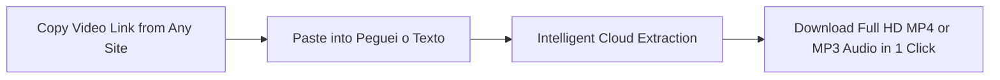
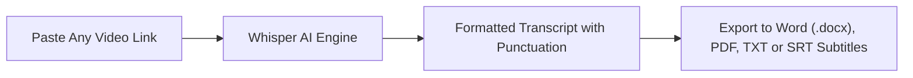

The search for **"download video from link"** (or *how to download videos by URL*) is one of the most consistent queries across the global internet. Every day, millions of people receive or discover video links shared across WhatsApp, Telegram, Slack, social feeds, or web browsers and want one straightforward solution: **paste the link into a search box and save the clean video file (.mp4) directly to mobile or desktop storage**.

It might be an essential lecture video to watch offline on a flight, an inspirational cooking Reel, a hilarious watermark-free TikTok clip, a YouTube masterclass, or breaking news from Twitter/X.

Unfortunately, the vast majority of web users encounter enormous frustration: more than **90% of pages promising "download video by link" are littered with deceptive ad banners**, screen-locking fake virus popups, misleading buttons, and malicious browser extensions that harvest browsing data.

In this **definitive, updated 2026 guide**, you will discover the fastest, modern, and 100% secure method to **download video from any link** in high definition (**Full HD MP4**) from virtually any web platform, learn how to do it on mobile (Android and iPhone) and PC/Mac, and discover a revolutionary tool: how to convert spoken dialogue from any video link into editable text in under 60 seconds.

---

## How Does Cloud-Based Video Link Extraction Work?

To understand why some downloaders deliver flawless files while others corrupt media, look under the hood of streaming technologies:

When you watch a video on YouTube, TikTok, Instagram, or Facebook, the platform does not deliver a single static file. Instead, it streams using advanced adaptive protocols (like **HLS** or **DASH**), slicing media into small audio and video chunks to conserve mobile bandwidth.

* **Legacy / Shady Converters**: Attempt to scrape only the first raw stream fragment, yielding corrupted clips, low-resolution 360p files, or completely muted audio.
* **Modern Cloud Engines (like Peguei o Texto)**: Connect directly to original content distribution servers, stitch together the Full HD video feed and the highest-bitrate stereo audio track, multiplex them on remote servers, and serve a clean `.mp4` file ready for instant playback.

> **Zero Software Needed**: You do not have to install heavy desktop suites, suspicious apps, or invasive browser extensions. Everything processes seamlessly in the cloud within seconds.

---

## The Hidden Hazards of Ad-Heavy Link Converters (SaveFrom, Y2Mate & Clones)

Searching for "download video link" frequently surfaces outdated converter clones that monetize aggressively:

1. **Browser Notification Hijacking**: An overlay interrupts the process reading *"Click Allow to continue"*. Doing so authorizes the site to spam your operating system with deceptive scam popups and gambling ads.
2. **Deceptive Download Buttons**: Pages feature half a dozen colorful *"Download Now"* or *"Start Download"* banners. In reality, almost all are disguised ads pointing to phishing traps or malware installers.
3. **Artificial Speed Throttling**: Many services intentionally bottleneck download bandwidth to force users into purchasing expensive and unnecessary "VIP" passes.

---

## Method 1: Download Video by Link on Peguei o Texto (Recommended, Universal & Virus-Free)

The most reliable tool to **download videos simply by pasting the link** from any web platform with zero malware risk and in top quality (**Full HD MP4** or **MP3** extraction) is [Peguei o Texto](/en/download-youtube-video).

The platform provides universal compatibility with over 1,700 web video services, including:
* **YouTube**: Long-form videos, keynote masterclasses, and YouTube Shorts in 1080p Full HD;
* **Instagram**: Reels, IGTV, and feed videos in original resolution;
* **TikTok**: Full HD MP4 videos **100% free of bouncing watermarks**;
* **Facebook**: Watch videos, livestreams, and Facebook Reels;
* **Twitter / X**: Tweet videos and animated GIFs converted into lightweight MP4;
* **Pinterest**: Video pins with full, synchronized audio;
* **LinkedIn, Vimeo, Kwai, Reddit, Twitch**: Clips, recordings, and webinars.



### Step-by-Step Instructions:

1. Open the app or website where the video is hosted (YouTube, Instagram, TikTok, etc.).
2. Click or tap the **Share** button on the post and select **"Copy link"** (or copy the URL from your desktop browser address bar).
3. Open the free [Peguei o Texto Video Downloader](/en/download-youtube-video) page in your browser.
4. Paste the URL into the center search bar and click **"Search Video"**.
5. The system identifies the media in roughly two seconds and displays direct download options:
   * **"Download Video (MP4 HD)"**: Saves high-resolution video and audio combined;
   * **"Download Audio (MP3)"**: Extracts only the sound track (music, podcast, or spoken dialogue).
6. Click your preferred format and the download starts immediately on your device without intrusive ads!

---

## Method 2: How to Download Video by Link on Mobile (Android & iPhone)

Over 75% of link downloads take place on mobile devices. Follow these steps to save files directly to your gallery:

### On Android:
1. In your social app of choice, tap **Share** > **Copy link**.
2. Open your mobile browser (**Google Chrome**, **Samsung Internet**, or **Brave**) and visit `pegueiotexto.com.br/en/download-youtube-video`.
3. Paste the URL into the search field and tap **"Search Video"**.
4. Tap **"Download Video (MP4 HD)"**.
5. The file saves directly to your device's **Downloads** folder and instantly appears in your **Gallery** or **Google Photos**.

### On iPhone & iPad (iOS):
On iOS devices, **Safari** provides a native and private download manager:
1. Copy the video link from any app.
2. Open **Safari** and go to [Peguei o Texto](/en/download-youtube-video).
3. Paste the link and tap **"Download Video (MP4 HD)"**.
4. Safari displays a prompt: *"Do you want to download this file?"* — tap **"Download"**.
5. Tap the blue download icon in Safari's address bar, open the downloaded file, tap the **Share** icon (box with upward arrow), and select **"Save Video"**.
6. The video is saved directly into your camera roll within the native **Photos** app!

---

## Method 3: How to Download Video by Link on Desktop (Windows, Mac & Linux)

For video editors, content creators, and professionals working on desktop:

1. In your desktop browser, navigate to the post containing the video.
2. Copy the full URL from the browser address bar (`Ctrl + C` on Windows or `Cmd + C` on Mac).
3. Open the [Peguei o Texto Downloader](/en/download-youtube-video).
4. Paste the link with `Ctrl + V` (or `Cmd + V`) and confirm.
5. Click **"Download Video (MP4 HD)"** and select your desired destination folder.

---

## Method 4: yt-dlp (The Open-Source Standard for Any Video URL)

For developers, automation engineers, and archivists, **yt-dlp** is the gold standard CLI tool:

```bash
# Download video from any link with best video and audio merged into MP4
yt-dlp -f "bestvideo+bestaudio/best" --merge-output-format mp4 "https://YOUR_VIDEO_URL"
```

yt-dlp supports over 1,700 sites and receives updates almost daily from open-source contributors on GitHub. Peguei o Texto leverages equivalent cloud power to offer the same reliability through an accessible browser interface with zero setup required.

---

## Comparison Table: Best Ways to Download Video by Link in 2026

| Method / Tool | Platforms Supported | Max Resolution | Malware Risk? | Deceptive Popups? | Extract MP3 Audio? | Transcribe with AI? |
| :--- | :--- | :--- | :--- | :--- | :--- | :--- |
| 🚀 **[Peguei o Texto](/en/download-youtube-video)** | **YouTube, TikTok, Insta, Face, X, Pinterest +1,700 sites** | **1080p Full HD** | **Zero Risk** | **Zero Popups** | **Yes (1-Click)** | **Yes (Whisper AI)** |
| 🌐 **Ad-Heavy Downloaders** | Limited Platforms | Usually 720p | High (Adware) | Yes (Dozens) | Limited | No |
| 🧩 **Browser Extensions** | Variable | Variable | Medium (Privacy) | Some | Rare | No |
| 💻 **yt-dlp (CLI)** | 1,700+ websites | Original Source | Zero Risk | Zero Ads | Yes (via FFmpeg) | No |

---

## Don't Just Save the Video: Extract Audio or Transcribe with AI!

In many cases, downloading a heavy video file is not what you actually need. What you truly want is the **spoken intelligence within the video**:

* Executive summaries from webinars, masterclasses, or virtual conferences;
* Dialogue quotes from interviews for research, journalism, or dissertations;
* Recipe ingredient lists and instructions from cooking reels;
* Synchronized `.srt` subtitle files for video editing in Premiere Pro or CapCut.

Instead of scrubbing through long videos and manually typing notes, use Peguei o Texto's [AI Video Transcription](/en/transcribe-youtube) tool:



Powered by the **Whisper** speech model, AI transcribes spoken dialogue in seconds with grammatical accuracy, allowing instant export to **Word (.docx)**, **PDF**, **TXT**, or **.SRT** subtitle files.

---

## Frequently Asked Questions (FAQ)

### 1. Is it safe to download videos by pasting links online?
Yes, as long as you rely on modern browser-based tools that require no software installations (`.exe` or `.apk`) and never request notification permissions. [Peguei o Texto](/en/download-youtube-video) operates 100% in the cloud, guaranteeing total safety against malware.

### 2. Which social networks and platforms are supported?
The tool supports URLs from all major platforms: YouTube (videos, live replays, and Shorts), TikTok (without logo), Instagram (Reels and feed videos), Facebook (Watch and Reels), Twitter/X, Pinterest (with synchronized audio), LinkedIn, Vimeo, Kwai, Reddit, and more than 1,700 sites.

### 3. Why do some links fail to load?
Common reasons include:
* The video is posted on a private account or restricted group requiring login;
* The original post was removed by the author;
* The copied link contains broken redirect parameters (try copying the direct canonical URL).

### 4. Can I extract just the audio or background music in MP3 from a link?
Yes! When you paste the URL into Peguei o Texto, simply click **"Download Audio (MP3)"**. The system extracts the pure audio track in high fidelity, saving space on your device.

---

## Conclusion: Paste the Link and Save Any Video in Seconds

Downloading videos by link should never be a frustrating ordeal full of deceptive ads, malware warnings, and muted files. With modern, secure solutions like [Peguei o Texto](/en/download-youtube-video), you can save your favorite videos from anywhere on the web in Full HD MP4 and extract audio in MP3 with complete confidence.

And when you need to turn spoken video content into written notes, let Artificial Intelligence transcribe hours of dialogue into structured documents in seconds!
