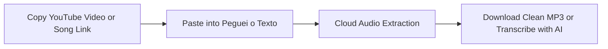

**YouTube** is the largest sonic library on earth. Far beyond official music videos released by record labels, the platform is home to rare acoustic live sessions, unforgettable concert performances, exclusive bootleg remixes, full DJ sets, relaxing study *lo-fi beats*, and instrumental backing tracks that simply **do not exist on Spotify, Apple Music, or Deezer**.

For this reason, searching for **how to download music from YouTube to MP3** for offline listening on smartphones, car USB flash drives, or at the gym is a daily routine for millions of people worldwide.

The primary issue is that most traditional *"YouTube to MP3"* online converters have become hazardous: they are loaded with intrusive online casino popups, deceptive redirects alerting users to fake viruses, and even covert spyware.

In this **definitive 2026 guide**, you will discover the **safest, fastest, and virus-free methods to download music from YouTube**, how to ensure the highest acoustic fidelity, and how to extract lyrics or spoken content using Artificial Intelligence.

---

## Security Warning: Beware of Shady Online Web Converters

When typing terms like "youtube mp3 converter" into search engines, the top results are often traps for unsuspecting users:

1. **Fake Notification Popups**: A dialog appears requesting you click *"Allow"* to unlock the MP3 download. Once clicked, the site inundates your browser with malicious system warnings (*"Your device is infected"*) and intrusive push ads.
2. **Lossy Re-encoding & Fake "320 kbps" Claims**: Many websites promise "320 kbps" audio quality, but in reality take a noisy 64 kbps compressed stream and bloat the file size without any true gain in acoustic fidelity.
3. **Disguised Executable Downloads**: Clicking the download button spawns secondary tabs that download suspicious executables (`.exe`, `.scr`, or `.apk`) instead of a clean `.mp3` audio track.

> **Safety Tip**: A legitimate audio download will always carry the `.mp3`, `.m4a`, or `.wav` extension. If a download requests administrator permissions or delivers an executable file, delete it immediately.

---

## Method 1: Download MP3 Music with Peguei o Texto (Online, Free & Secure)

If you need a clean online tool that operates directly in your mobile or desktop web browser—**with zero invasive popups, zero deceptive traps, and 100% security**—the top choice is the [Peguei o Texto YouTube to MP3 Converter](/en/youtube-to-mp3).

Engineered to provide direct, clean downloads, the service extracts the audio stream from any YouTube video or music clip in high-fidelity MP3 format without requiring registration.



### Step-by-Step Instructions:
1. Open YouTube on mobile or desktop, find your preferred song or concert, and click **Share** > **Copy Link**.
2. Visit the [YouTube to MP3 Converter](/en/youtube-to-mp3) page.
3. Paste the URL into the search box and click **"Search Video"**.
4. The system processes the media instantly. Click **"Download MP3 Audio"**.
5. The download starts directly into your device's download folder without redirects or popups.

*Intelligent Bonus*: In addition to saving the track, an integrated button allows you to **transcribe the audio with Artificial Intelligence**, making it effortless to extract lyrics, speeches, or keynote notes in seconds!

---

## Method 2: YouTube Music (The Official DRM-Protected Method)

For listeners who want ad-free listening and offline playback on iOS or Android devices backed by official support, **YouTube Music** (bundled with YouTube Premium) is the native subscription-based option.

### How it works:
1. Open the **YouTube Music** app on Android or iOS.
2. Search for the track, album, or playlist you want.
3. Tap the **three-dots menu** next to the song and tap **"Download"**.
4. The songs are stored within the "Library" > "Downloads" tab, ready for offline playback during flights or commutes.

### Pros & Limitations:
* **Pros**: High-bitrate official audio (AAC at 256 kbps), unified catalog featuring all live bootlegs on YouTube, background playback with the screen off, and synchronized real-time lyrics.
* **Limitations**: Requires a recurring paid subscription and files are DRM-encrypted inside the app. **You cannot export a standalone `.mp3` file** to place onto a car USB drive or vintage MP3 player.

---

## Method 3: VLC Media Player (Free, Open-Source & Desktop-Friendly)

The open-source **VLC Media Player** is among the safest tools for **Windows, Mac, and Linux** users wanting to extract YouTube tracks without untrusted web utilities:

### How to extract audio with VLC:
1. Copy the YouTube video URL.
2. Launch **VLC Media Player**.
3. In the top menu, go to **Media** > **Convert / Save...** (shortcut: `Ctrl + R` on Windows, `Cmd + Shift + S` on Mac).
4. Select the **Network** tab, paste the YouTube URL into the box, and click the arrow next to "Convert / Save" to choose **Convert**.
5. In the profile dropdown, select **Audio - MP3**.
6. Set your destination file name and path ending in `.mp3`, then click **Start**.
7. VLC streams the audio and compiles a standalone MP3 file directly to your disk.

---

## Method 4: yt-dlp (For Audiophiles: Maximum Fidelity with Tags & Album Art)

For digital audio collectors, DJs, and power users who require absolute maximum audio quality—complete with embedded ID3 tags, album art thumbnails, and native bitrates—the industry benchmark is **yt-dlp**.

### How to use yt-dlp for audio extraction:
1. **Installation**:
   * Windows: Open PowerShell or Terminal and run `winget install yt-dlp` and `winget install ffmpeg`.
   * macOS: Run `brew install yt-dlp ffmpeg`.
2. **Terminal Command for Pristine Quality**:
   ```bash
   yt-dlp -x --audio-format mp3 --audio-quality 0 --add-metadata --embed-thumbnail "YOUR_YOUTUBE_URL"
   ```
3. The tool captures the purest audio stream, converts it via LAME to variable bitrate MP3 (VBR 0 / equivalent to 320 kbps), embeds the thumbnail image, and tags artist and track title accurately.

---

## Method 5: How to Download YouTube Music on Mobile (Android & iPhone)

### On Android Devices:
1. Open the YouTube app, tap **Share** > **Copy Link** on the desired music video.
2. Open your mobile browser (Chrome or Brave) and navigate to the [Peguei o Texto YouTube to MP3 Converter](/en/youtube-to-mp3).
3. Paste the URL and tap **Download MP3**.
4. The file saves to your device's "Downloads" folder and is immediately playable in Samsung Music, VLC for Android, or local Spotify files.

### On iPhone & iPad (iOS):
iOS enforces sandboxing rules on direct web downloads, but you can easily manage audio files:
1. Install the free **Documents by Readdle** app from the App Store.
2. Use the built-in browser inside Documents to visit `pegueiotexto.com.br/en/youtube-to-mp3`.
3. Paste the YouTube link and initiate the MP3 download.
4. The track saves inside the Documents "Downloads" directory, enabling lock-screen background playback or export to the native iOS Files app and iCloud Drive.

---

## Understanding Audio Quality: The 320 kbps YouTube Myth

There is widespread confusion surrounding bitrates when saving audio from YouTube:

| Format / Bitrate | Acoustic Quality | How YouTube Streams It |
| :--- | :--- | :--- |
| **64 kbps to 96 kbps** | Low / Muffled | Low-bandwidth fallback for slow mobile connections. High frequencies are truncated. |
| **128 kbps to 160 kbps** | Good / Standard | **The native broadcast bitrate YouTube uses for standard videos** (in Opus and AAC formats). |
| **256 kbps (AAC)** | Very High | Premium bitrate delivered across YouTube Music for paid subscribers. |
| **320 kbps (MP3)** | Maximum MP3 Fidelity | The gold standard for `.mp3`. Converting YouTube's native 160 kbps Opus/AAC stream with modern encoders (like LAME) preserves all harmonic nuances present in the source. |

> **Crucial Takeaway**: If a YouTube upload was recorded with an inferior laptop microphone or noisy background hum, no audio converter can magically turn it into Abbey Road studio masters. However, a reputable converter guarantees zero degradation beyond the original source file.

---

## Need Song Lyrics or Spoken Notes? Use AI Transcription

Frequently, the motive behind downloading foreign songs, rapid rap tracks, or worship music is to **read the exact lyrics**, master pronunciation, or transcribe musical chords.

Likewise, many users download audio from **music podcasts, artist interviews, masterclasses, and keynote speeches**.

### How AI Streamlines This:
Rather than pausing the playback every three seconds to transcribe what was said, leverage [Peguei o Texto](/en/transcribe-youtube) to convert speech to text seamlessly:

1. **Structured Transcripts**: Transcribe music lyrics, interviews, and panel discussions with punctuation and speaker clarity.
2. **Instant Export**: Save your transcripts directly as **Word (.docx)**, **PDF**, or **TXT** files for studying or sharing.
3. **Synchronized Subtitles**: If you are a video editor or content creator, generate `.srt` files for Instagram Reels and TikTok (see our guide on [how to generate SRT subtitles](/en/blog/how-to-generate-srt-subtitles)).

To explore leading tools for handling sound files, explore our breakdown of the [best tools to convert MP3 to text in 2026](/en/blog/how-to-convert-mp3-to-text).

---

## Comparison Table: Which Method Fits Your Needs?

| Method | Safety | Audio Quality | Cost | Difficulty | Best For |
| :--- | :--- | :--- | :--- | :--- | :--- |
| 🚀 **[Peguei o Texto](/en/youtube-to-mp3)** | **100% Safe (No Ads/Popups)** | **High-Fidelity MP3** | **Free** | **Instant (1-Click)** | **Single track downloads, car USBs, zero malware risk** |
| 🎧 **YouTube Music** | Official (Google) | AAC 256 kbps | Monthly Fee | Very Easy | Mobile listening with screen off and no ads |
| 🎬 **VLC Media Player** | 100% Safe (Open Source) | MP3 / Original | Free | Intermediate | Desktop conversions without third-party web apps |
| ⚡ **yt-dlp** | 100% Safe (Open Source) | Up to 320 kbps / FLAC | Free | Advanced (CLI) | Music archivists, audiophiles, full playlists |
| 🌐 **Legacy Web Converters** | ⚠️ High Malware Risk | Inconsistent | Free | High Risk | Not recommended |

---

## Frequently Asked Questions (FAQ)

### 1. How do I transfer downloaded MP3s from YouTube to a USB flash drive?
After downloading the `.mp3` file to your computer using [Peguei o Texto](/en/youtube-to-mp3), insert your flash drive into a USB port. Open your computer's "Downloads" folder, select the music files, and drag them into the USB drive directory. MP3 files are universally recognized by car stereos, home audio systems, and Bluetooth speakers.

### 2. Can I download an entire YouTube playlist at once?
Yes. For downloading complete playlists containing dozens of songs safely and in bulk, the most effective tool is **yt-dlp**, which systematically parses playlists and auto-numbers tracks sequentially.

### 3. How can I trim a downloaded MP3 to make a phone ringtone?
Once you have saved the MP3, use free audio editors such as *Audacity* on desktop or *WavePad* on mobile to isolate your favorite chorus and export it as an iPhone ringtone (M4R) or Android ringtone (MP3).

### 4. What is the difference between MP3, M4A, and WAV?
* **MP3**: The most widely supported audio standard globally, playable on every device with an optimal balance of file size and quality.
* **M4A (AAC)**: Apple's modern compression format offering superior acoustic efficiency compared to MP3 at equivalent file sizes.
* **WAV**: Uncompressed lossless audio that mirrors studio recordings perfectly, resulting in file sizes roughly 10 times larger.

---

## Conclusion

Downloading music from YouTube into MP3 format is a convenient way to ensure your favorite rare mixes, acoustic performances, and songs remain accessible during travel, gym sessions, and offline commutes.

To keep your personal devices secure, leave behind dangerous spam-filled conversion websites. Rely on secure, modern solutions like [Peguei o Texto YouTube to MP3 Converter](/en/youtube-to-mp3), **YouTube Music**, **VLC**, or **yt-dlp**.

And whenever you need accurate lyrics, study notes, or AI-powered summaries from your audio files, try [Peguei o Texto](/en/transcribe-youtube) for effortless transcription!
