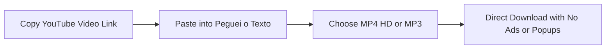

Learning **how to download YouTube videos** is among the most requested web capabilities. Whether you need to watch lectures during long flights without internet, archive essential technical tutorials, save keynote speeches, or study without buffering issues, having access to offline media provides unmatched convenience.

However, searching on Google for free video downloaders usually leads into a cybersecurity minefield: over **90% of free video download sites** are saturated with aggressive popups, deceptive security warnings (*"Your computer has been infected with malware!"*), invasive trackers, and bundled adware installers.

To safeguard your digital privacy and save valuable time, we crafted this **definitive 2026 guide**. Here you will discover the **safest, battle-tested methods to download YouTube videos** on PC, Mac, Android, and iPhone, learn how to bypass online traps, and explore a game-changing alternative: **do you genuinely need the heavy video file, or do you simply need the spoken information inside it?**

---

## Security Warning: The Hidden Dangers of Free Video Downloaders

Before clicking the first search result promising "instant 1-click free downloads", understand how rogue download websites operate:

1. **Deceptive Notification Prompts**: Nearly all older converters display a browser popup asking you to click *"Allow"* to unlock your download. Doing so grants the site permission to blast your device screen with scam warnings, fake antivirus alerts, and adult gaming ads.
2. **Deceptive Download Buttons**: The page layout is typically cluttered with dozens of brightly colored *"Download Now"* or *"Start Download"* banners that are actually disguised affiliate ads. The real download button is often concealed, minuscule, or locked behind arbitrary countdown timers.
3. **Bundled Adware and Spyware**: Some tools insist you download a `.exe` installer or add an unknown Chrome extension. These programs can hijack your default search engine, inject popups into other websites, and harvest your web browsing history.

> **Golden Rule**: Never execute `.exe` files or accept browser notifications to unlock video downloads. If a site demands you install unfamiliar software, close the tab immediately.

---

## Method 1: Download YouTube Videos Safely Online with Peguei o Texto (Recommended)

If you are looking for an online tool that works directly within your web browser—with zero software installation and, most importantly, **zero deceptive popups, zero fake ads, and zero malware risk**—the cleanest solution is [Peguei o Texto YouTube Video Downloader](/en/download-youtube-video).

Built to deliver a fast, transparent experience, the service allows you to save regular videos and **YouTube Shorts** in high-definition (**MP4 HD**) or extract the audio track in **MP3** for free.



### How to use the online downloader:
1. Open YouTube (on mobile or desktop), click **Share** below the video, and click **"Copy Link"**.
2. Visit the free [YouTube Video Downloader](/en/download-youtube-video) page.
3. Paste the URL into the search field and click **"Search Video"**.
4. The system detects the video instantly. Select whether you want **Video (MP4 HD)** or **Audio (MP3)**.
5. The download starts directly to your device without routing through external ad servers.

*Exclusive Feature*: If you are saving the video for work or academic study, Peguei o Texto includes an integrated button to **transcribe the video into text using Artificial Intelligence** in under a minute!

---

## Method 2: YouTube Premium (The Official & Legal Method)

The official alternative provided by Google for offline viewing is a **YouTube Premium** subscription.

### How it works:
YouTube provides an official download button inside the mobile app (Android and iOS) as well as desktop browsers for subscribers:

1. Navigate to the desired video within the YouTube app or browser.
2. Click the **"Download"** button located below the video player.
3. Choose your desired resolution (up to 1080p Full HD).
4. The video downloads directly to the **"Downloads"** tab in your library.

### Pros and Cons of YouTube Premium:
* **Pros**: 100% legal, zero malware risk, removes all YouTube advertisements, supports background playback with your phone screen turned off, and bundles YouTube Music streaming.
* **Limitations**: Downloaded media is DRM-encrypted inside the app and **cannot be exported as a standalone `.mp4` file** for video editing in Premiere or CapCut, or sharing on WhatsApp. Requires an active monthly subscription and requires reconnecting to the internet at least once every 30 days to keep downloads active.

---

## Method 3: VLC Media Player (Free, Safe & Open-Source)

The renowned open-source media player **VLC** includes a built-in feature to stream and extract raw video feeds directly from YouTube without showing a single advertisement.

This approach is ideal for **Windows, Mac, and Linux** desktop users:

### Step-by-Step Instructions for VLC:
1. Copy the YouTube video URL you want to save.
2. Launch **VLC Media Player** on your computer.
3. In the top menu, go to **Media** (Windows) or **File** (macOS) and click **"Open Network Stream..."** (shortcut: `Ctrl + N` on Windows, `Cmd + N` on Mac).
4. Paste the YouTube URL into the network box and click **"Play"**.
5. The video begins playing inside VLC. While it plays, navigate to **Tools** > **Codec Information** (shortcut: `Ctrl + I` on Windows, `Cmd + I` on Mac).
6. At the bottom of the window, locate the field labeled **"Location"**. Double-click the entire string and copy it (`Ctrl + C`).
7. Open your regular web browser, paste this URL into the address bar, and press `Enter`.
8. The raw MP4 stream loads directly from Google's servers. Right-click the video and choose **"Save video as..."** to save the original `.mp4` file locally!

---

## Method 4: yt-dlp (The Ultimate Tool for Creators & Power Users)

If you need to download videos in **4K**, **1080p at 60 FPS**, archive complete playlists, or extract lossless audio tracks, the world's most powerful open-source command-line tool is **yt-dlp**.

Maintained cooperatively on GitHub as the modern fork of *youtube-dl*, yt-dlp runs via terminal, displays zero ads, logs zero data, and is trusted by media professionals globally.

### How to use yt-dlp:
1. **Installation**:
   * Windows: Open PowerShell or Terminal and run `winget install yt-dlp`.
   * macOS: Run `brew install yt-dlp`.
2. **Download in Best MP4 Quality**:
   ```bash
   yt-dlp -f "bestvideo[ext=mp4]+bestaudio[ext=m4a]/best[ext=mp4]" "YOUR_VIDEO_URL"
   ```
3. The video downloads at top bandwidth directly to your active folder.

---

## Method 5: How to Download YouTube Videos on Mobile (Android & iPhone)

### On Android:
* **Via Web Browser**: Open [Peguei o Texto Downloader](/en/download-youtube-video) in Chrome or Brave, paste the video link or Shorts URL, and tap download MP4. The file saves directly to your device's Downloads folder and shows up in Google Photos or Gallery.
* **YouTube Premium**: Ideal if you only need offline viewing within the official app without using device storage for gallery files.

### On iPhone and iPad (iOS):
Apple enforces strict security sandboxing on direct web file downloads:
1. Install the free **Documents by Readdle** app from the App Store.
2. Open the built-in browser inside Documents and navigate to [Peguei o Texto](/en/download-youtube-video).
3. Paste the YouTube URL and tap download MP4.
4. Tap the three dots next to the saved video in Documents, select **"Share"**, and choose **"Save Video"** to export it to your iOS Photos camera roll.

---

## Do You Actually Need the Video File? (The AI Text Revolution)

Before filling gigabytes of disk space on your computer or smartphone, ask yourself: **what is your actual goal with this video?**

Digital consumption analytics show that over **70% of video downloads** for work and education have one goal:
* Taking notes on webinars, courses, and educational lectures.
* Summarizing recorded meetings or conference panels.
* Extracting quotes and statements from podcasts and interviews.
* Citing exact dialogue for academic research, business plans, or legal filings.

### The Problem with Downloading Videos for Study:
A 1-hour Full HD video takes between **1 GB and 2 GB of storage space**. Furthermore, after downloading, you still have to spend hours scrubbing through the footage, pausing every few seconds to type what was said.

### The Smart Alternative: Convert the Video into Structured Text
Instead of bloating your device with heavy video files, use Peguei o Texto's [Transcribe YouTube Video](/en/transcribe-youtube) tool.

Simply paste the YouTube URL: our Artificial Intelligence engine processes the audio in the cloud and delivers in under 1 minute:
1. **Complete Verbatim Transcript**: Formatted text with correct grammar, paragraphs, and speaker labels.
2. **Flexible Export Options**: Download your completed transcript as **Word (.docx)**, **PDF**, or **TXT**.
3. **Massive Time Savings**: Reading a 1-hour video transcript takes only **10 to 15 minutes**.
4. **Instant Keyword Search (`Ctrl + F`)**: Find any metric, quote, or concept in milliseconds.
5. **Synchronized Subtitles**: If you are a creator, generate `.srt` subtitle files to caption your videos (see our guide on [how to generate SRT subtitles](/en/blog/how-to-generate-srt-subtitles)).

To master the full workflow, read our in-depth tutorial on [how to transcribe YouTube video to text](/en/blog/how-to-transcribe-youtube-video-to-text).

---

## Comparison Table: Which Method Fits You Best?

| Method | Security Level | Max Quality | Cost | Ease of Use | Best For |
| :--- | :--- | :--- | :--- | :--- | :--- |
| 🚀 **[Peguei o Texto](/en/download-youtube-video)** | **100% Safe (No Ads/Popups)** | **MP4 HD / MP3** | **Free** | **Instant (1-Click)** | **Quick downloads without malware or transcribing with AI** |
| 🛡️ **YouTube Premium** | Official (Google) | 1080p | Monthly Subscription | Very Easy | Offline ad-free watching in the official app |
| 🎬 **VLC Media Player** | 100% Safe (Open Source) | Original Quality | Free | Intermediate | Downloading MP4 on PC without third-party web apps |
| ⚡ **yt-dlp** | 100% Safe (Open Source) | Up to 4K / 60 FPS | Free | Advanced (CLI) | Creators, archivists, and video editors |
| 🌐 **Legacy Web Downloaders** | ⚠️ High Malware Risk | Usually 720p | Free | High Risk | Not recommended |

---

## Frequently Asked Questions (FAQ)

### 1. How do I download just the audio from a YouTube video to MP3?
You can use the [Peguei o Texto YouTube Downloader](/en/download-youtube-video) and select "Download Audio (MP3)". If you need to convert that audio into an editable text document for reading or research, check our breakdown of the [best tools to convert MP3 to text in 2026](/en/blog/how-to-convert-mp3-to-text).

### 2. Can I transcribe any YouTube video directly from the URL?
Yes! With [Peguei o Texto AI Transcription](/en/transcribe-youtube), you do not need to download heavy video files. Just paste the YouTube URL, and our AI analyzes the speech in the cloud, returning a full transcript and executive summary in seconds.

### 3. Is it safe to use Chrome extensions to download YouTube videos?
No. The Chrome Web Store strictly bans any extensions that download YouTube videos to protect Google's ad ecosystem. Extensions claiming this capability require sideloading in "developer mode", which poses serious security hazards including credential theft.

---

## Conclusion: Download Safely and Supercharge Your Productivity

Downloading YouTube videos is extremely handy when you need reliable offline access. However, your device security and personal privacy must always come first. Avoid suspicious websites laden with abusive ads and rely on trusted alternatives like [Peguei o Texto](/en/download-youtube-video), **YouTube Premium**, **VLC**, or **yt-dlp**.

And when your objective is to study, produce lecture summaries, or save time, take the modern step forward: rather than accumulating heavy video files, **convert spoken audio into structured text with Artificial Intelligence**.

Try [Peguei o Texto](/en/transcribe-youtube) for free today and elevate your productivity to new heights!
