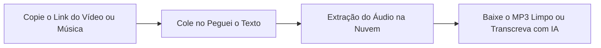

O **YouTube** é o maior acervo sonoro do planeta. Muito além dos videoclipes oficiais das gravadoras, a plataforma reúne versões acústicas raras, apresentações ao vivo inesquecíveis, remixes exclusivos, sets completos de DJs, *lofi beats* relaxantes para estudo e trilhas instrumentais que simplesmente **não existem no Spotify, Apple Music ou Deezer**.

Por esse motivo, pesquisar sobre **como baixar músicas do YouTube em MP3** para ouvir offline no celular, no pendrive do carro ou na academia é uma rotina de milhões de brasileiros.

O grande problema é que a maioria dos conversores online tradicionais de *"YouTube para MP3"* tornou-se perigosa: estão repletos de popups abusivos de cassinos online, redirecionamentos enganosos que alertam sobre falsos vírus e até programas espiões (*spywares*).

Neste **guia definitivo para 2026**, você vai aprender os **métodos mais seguros, rápidos e livres de vírus para baixar músicas do YouTube**, como garantir a melhor fidelidade sonora e como extrair a letra ou o conteúdo falado de qualquer áudio usando Inteligência Artificial.

---

## O Alerta de Segurança: Cuidado com os Conversores Piratas da Web

Ao digitar termos como "conversor youtube mp3" em mecanismos de busca, os primeiros resultados costumam ser armadilhas para usuários desavisados:

1. **Popups de Notificações Falsas**: Uma janela surge solicitando clique em *"Permitir"* para liberar o arquivo MP3. Ao aceitar, o site passa a bombardear seu navegador com alertas falsos (*"Seu dispositivo foi hackeado"*) e propagandas maliciosas.
2. **Compressão Destrutiva e Falso "320 kbps"**: Muitos sites prometem áudio em "320 kbps", mas na verdade pegam uma faixa comprimida em 64 kbps cheia de ruídos e apenas inflam o tamanho do arquivo, sem nenhuma melhora de fidelidade acústica.
3. **Downloads Mascarados**: Ao clicar em "Download", uma aba secundária baixa executáveis com extensões suspeitas (`.exe`, `.scr` ou `.apk`) em vez de um arquivo sonoro puro em `.mp3`.

> **Dica de Segurança**: Um arquivo legítimo de áudio terá sempre a extensão `.mp3`, `.m4a` ou `.wav`. Se o download solicitar permissões de administrador ou baixar um arquivo executável, delete-o imediatamente.

---

## Método 1: Baixar Músicas em MP3 no Peguei o Texto (Online, Grátis e Seguro)

Se você busca uma ferramenta online que funcione diretamente pelo navegador do celular ou computador, **sem anúncios invasivos, sem popups chatos e 100% segura**, a melhor opção é o [Conversor de YouTube para MP3 do Peguei o Texto](/baixar-audio-youtube-mp3).

Desenvolvido para oferecer downloads transparentes e limpos, o serviço extrai a trilha sonora de qualquer vídeo ou clipe do YouTube em formato MP3 de alta fidelidade sem exigir cadastro.



### Passo a passo para baixar sua música:
1. Abra o YouTube (no aplicativo ou no computador), encontre a música ou show desejado e clique em **Compartilhar** > **Copiar Link**.
2. Acesse a página do [Baixador de Áudio do YouTube em MP3](/baixar-audio-youtube-mp3).
3. Cole a URL no campo de busca e clique em **"Buscar Vídeo"**.
4. O sistema processará a mídia instantaneamente. Clique em **"Baixar Áudio em MP3"**.
5. O download será iniciado diretamente para a pasta de arquivos do seu dispositivo, sem redirecionamentos.

*Bônus Inteligente*: Além de baixar a música, você tem à disposição um botão integrado para **transcrever o áudio com Inteligência Artificial**, perfeito para extrair a letra da música, discursos ou anotações de aulas e palestras em segundos!

---

## Método 2: YouTube Music (O Método Oficial e sem Pirataria)

Para quem deseja ouvir músicas sem anúncios e salvá-las para reprodução offline no smartphone com total comodidade e suporte oficial, o **YouTube Music** (incluso no YouTube Premium) é a opção nativa recomendada.

### Como funciona:
1. Abra o aplicativo **YouTube Music** no Android ou iPhone.
2. Localize a faixa musical, álbum ou playlist desejada.
3. Toque no ícone de **três pontinhos** ao lado da faixa e escolha **"Fazer o download"**.
4. As músicas ficam armazenadas na aba "Biblioteca" > "Downloads", prontas para serem tocadas mesmo com o celular em modo avião ou sem sinal de internet.

### Vantagens e Limitações:
* **Vantagens**: Áudio em alta fidelidade oficial (AAC a 256 kbps), catálogo integrado com todas as versões ao vivo do YouTube, reprodução em segundo plano com tela apagada e sincronização de letras em tempo real.
* **Limitações**: Exige assinatura mensal paga e os arquivos ficam protegidos por DRM dentro do aplicativo, **não sendo possível exportar um arquivo `.mp3` avulso** para colocar em um pendrive de carro ou caixa de som portátil antiga.

---

## Método 3: VLC Media Player (Gratuito, Seguro e para Computadores)

O reprodutor de mídia open-source **VLC** é uma das ferramentas mais seguras para usuários de **Windows, Mac e Linux** que desejam converter faixas do YouTube sem instalar softwares suspeitos:

### Como extrair o áudio no VLC:
1. Copie o link do vídeo do YouTube.
2. Abra o **VLC Media Player**.
3. Vá no menu superior em **Mídia** > **Converter / Salvar...** (atalho: `Ctrl + R`).
4. Selecione a aba **Rede**, cole o link do YouTube no campo de URL e clique na setinha ao lado do botão "Converter / Salvar" escolhendo **Converter**.
5. Na janela de opções, selecione o Perfil **Áudio - MP3**.
6. Em "Arquivo de destino", escolha o local no seu computador onde a música será salva com a extensão `.mp3` e clique em **Iniciar**.
7. O VLC fará o streaming do áudio e criará o arquivo MP3 puro no seu computador.

---

## Método 4: yt-dlp (Para Audiófilos: Extração na Máxima Fidelidade com Tags e Capas)

Para colecionadores de música, produtores e audiófilos que exigem a maior fidelidade acústica possível (incluindo metadados ID3 automáticos, capa do álbum embutida e taxa de bits original), a ferramenta padrão da indústria é o **yt-dlp**.

### Como usar o yt-dlp para extrair músicas:
1. **Instalação**:
   * No Windows: Abra o terminal e instale com `winget install yt-dlp` e `winget install ffmpeg`.
   * No Mac: Instale via Homebrew com `brew install yt-dlp ffmpeg`.
2. **Comando para baixar a música com máxima qualidade e metadados**:
   Execute o seguinte comando no Terminal ou Prompt de Comando:
   ```bash
   yt-dlp -x --audio-format mp3 --audio-quality 0 --add-metadata --embed-thumbnail "URL_DA_MUSICA"
   ```
3. O software baixará o fluxo de áudio original, converterá para MP3 com taxa variável máxima (VBR 0 / equivalente a 320 kbps), inserirá a foto da capa do vídeo e os nomes corretos de artista e título no arquivo.

---

## Método 5: Como Baixar Músicas do YouTube no Celular (Android e iPhone)

### No Celular Android:
1. Abra o aplicativo do YouTube, localize a música e toque em **Compartilhar** > **Copiar link**.
2. Abra o navegador (Chrome ou Brave) e acesse o [Baixador de Áudio do Peguei o Texto](/baixar-audio-youtube-mp3).
3. Cole o link e toque em baixar MP3.
4. O arquivo irá para a pasta "Downloads" do celular e poderá ser reproduzido em qualquer player de música (Samsung Music, VLC para Android, YouTube Music em arquivos locais ou Spotify).

### No iPhone e iPad (iOS):
O sistema operacional da Apple restringe downloads diretos via Safari para players nativos, mas você pode salvar com facilidade:
1. Baixe o aplicativo gratuito **Documents by Readdle** na App Store.
2. Acesse o navegador integrado do Documents e entre em `pegueiotexto.com.br/baixar-audio-youtube-mp3`.
3. Cole a URL da música do YouTube e faça o download do MP3.
4. O arquivo ficará salvo na pasta "Downloads" do Documents, permitindo que você o escute com a tela apagada ou compartilhe para o app Arquivos do iOS e serviços de nuvem como Google Drive ou iCloud.

---

## Entendendo a Qualidade do Áudio: O Mito dos 320 kbps no YouTube

Existe muita desinformação sobre taxas de bits (*bitrate*) de músicas baixadas do YouTube:

| Formato / Taxa | Qualidade Sonora | Como Funciona no YouTube |
| :--- | :--- | :--- |
| **64 kbps a 96 kbps** | Baixa / Abafada | Formato econômico para redes móveis 3G lentas. Perde detalhes nos agudos. |
| **128 kbps a 160 kbps** | Boa / Padrão | **É a taxa nativa em que o YouTube transmite a maioria dos vídeos** (em formatos Opus e AAC). |
| **256 kbps (AAC)** | Muito Alta | Taxa utilizada no catálogo premium do YouTube Music para assinantes. |
| **320 kbps (MP3)** | Máxima Fidelidade MP3 | Padrão ouro para arquivos `.mp3`. Ao converter o fluxo nativo do YouTube com encoders modernos (como LAME), obtém-se o teto de fidelidade acústica que a gravação original oferece. |

> **Importante**: Se um vídeo do YouTube foi gravado com áudio ruim ou microfone com chiado, nenhum conversor fará mágica para transformá-lo em áudio de estúdio. No entanto, um bom conversor garante que você não perca nenhuma frequência sonora existente.

---

## Você Quer a Letra da Música ou Anotações de Áudio? Use IA

Muitas vezes, o objetivo de baixar uma música internacional, uma faixa de rap rápida ou uma canção religiosa é **acompanhar a letra exata (*lyrics*)**, entender pronúncias de idiomas estrangeiros ou tirar cifras para instrumentos musicais.

Além disso, muitas pessoas baixam áudios de **podcasts musicais, entrevistas com artistas e palestras com trilha sonora**.

### Como a Inteligência Artificial Resolve isso:
Em vez de ficar pausando a música a cada três segundos para tentar decifrar o que o cantor ou palestrante disse, você pode utilizar o [Peguei o Texto](/transcrever-youtube) para transformar o áudio em texto escrito:

1. **Letras Estruturadas**: Transcreva músicas e entrevistas com pontuação e separação por estrofes.
2. **Exportação Imediata**: Salve em **Word (.docx)**, **PDF** ou **TXT** para imprimir ou estudar.
3. **Legendas Sincronizadas**: Se você é músico ou editor, gere arquivos `.srt` para legendar seus clipes no Instagram Reels e TikTok (veja nosso guia de [como gerar legendas SRT](/blog/como-gerar-legendas-srt-para-videos-do-youtube-e-tiktok)).

Para aprofundar nas melhores ferramentas do mercado para lidar com arquivos sonoros, leia também nossa análise sobre as [melhores ferramentas para converter MP3 em texto em 2026](/blog/melhores-ferramentas-para-converter-mp3-em-texto-2026).

---

## Comparativo: Qual o Melhor Método para o Seu Perfil?

| Método | Segurança | Qualidade de Áudio | Custo | Dificuldade | Melhor Para |
| :--- | :--- | :--- | :--- | :--- | :--- |
| 🚀 **[Peguei o Texto](/baixar-audio-youtube-mp3)** | **100% Seguro (Sem Popups)** | **MP3 Alta Fidelidade** | **Grátis** | **Muito Fácil (1 Clique)** | **Baixar faixas avulsas e pendrive de carro sem risco de vírus** |
| 🎧 **YouTube Music** | Oficial (Google) | AAC 256 kbps | Mensalidade | Muito Fácil | Ouvir no celular com tela apagada e sem anúncios |
| 🎬 **VLC Media Player** | 100% Seguro (Open-Source) | MP3 / Original | Grátis | Média | Extrair áudio no computador sem navegadores |
| ⚡ **yt-dlp** | 100% Seguro (Open-Source) | Até 320 kbps / FLAC | Grátis | Avançada (Terminal) | Colecionadores, audiófilos e playlists completas |
| 🌐 **Conversores Antigos** | ⚠️ Risco Alto de Vírus | Inconsistente | Grátis | Alto risco | Não recomendado |

---

## Aspectos Jurídicos: É Crime Baixar Músicas do YouTube?

No Brasil, a **Lei de Direitos Autorais (Lei nº 9.610/98)** rege a cópia e o uso de criações intelectuais:

* **Uso Estritamente Privado**: O artigo 46, inciso II, estabelece que a cópia em um só exemplar de pequenos trechos ou obras para uso privado e pessoal do copista, sem intenção de lucro direto ou indireto, não constitui infração a direitos autorais. Portanto, baixar uma música para ouvir no fone de ouvido ou no carro não é crime.
* **Pirataria e Comercialização**: Vender pendrives com músicas baixadas, cobrar por coletâneas ou usar faixas comerciais com fins lucrativos sem recolhimento de direitos via ECAD é crime de contrafação e violação de direitos autorais.
* **Termos do YouTube**: Fazer download de músicas viola as regras contratuais da plataforma, mas essa violação é de natureza comercial/civil com o serviço, e não um delito criminal para o usuário comum doméstico.

---

## Perguntas Frequentes (FAQ)

### 1. Como passar as músicas baixadas do YouTube para um pendrive?
Após baixar o arquivo `.mp3` no seu computador (usando o [Peguei o Texto](/baixar-audio-youtube-mp3)), conecte o pendrive na porta USB, abra a pasta "Downloads", selecione as músicas e arraste-as diretamente para a pasta da unidade USB. O formato MP3 é compatível com praticamente 100% dos aparelhos de som automotivo e caixas de som Bluetooth.

### 2. É possível baixar uma playlist inteira de músicas de uma só vez?
Sim. Para baixar listas de reprodução completas com dezenas de músicas de forma automatizada e segura, o método mais indicado é o **yt-dlp**, pois ele faz a varredura da playlist inteira e numera as faixas em sequência com títulos organizados.

### 3. Como cortar apenas um trecho da música para toque de celular?
Depois de baixar o MP3 completo, você pode usar editores gratuitos como o *Audacity* no computador ou aplicativos como *WavePad* no smartphone para selecionar o refrão e salvar como toque de chamada (Ringtone).

### 4. Qual a diferença entre MP3, M4A e WAV?
* **MP3**: O formato mais universal do mundo, compatível com qualquer aparelho e com excelente equilíbrio entre compressão e qualidade.
* **M4A (AAC)**: Formato moderno da Apple com compressão mais eficiente do que o MP3 no mesmo tamanho de arquivo.
* **WAV**: Formato sem compressão (*lossless*), mantendo o áudio idêntico ao estúdio, mas gerando arquivos cerca de 10 vezes maiores.

---

## Conclusão

Baixar músicas do YouTube em MP3 é uma forma prática de garantir que suas canções, remixes e apresentações ao vivo favoritas estejam sempre com você, mesmo em viagens sem internet ou no som do carro.

Para proteger a segurança dos seus aparelhos, deixe no passado os sites piratas cheios de popups e armadilhas. Dê preferência a ferramentas confiáveis e rápidas como o [Baixador de Áudio do Peguei o Texto](/baixar-audio-youtube-mp3), o **YouTube Music**, o **VLC** ou o **yt-dlp**.

E se além de escutar a música você quiser a letra detalhada, anotações de aulas sonoras ou resumos estruturados com IA, experimente o [Peguei o Texto](/transcrever-youtube) gratuitamente e veja como é simples transformar áudio em texto em segundos!
