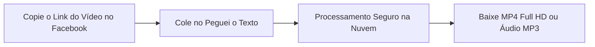
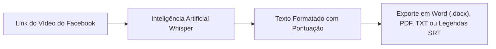

Aprender **como baixar vídeo do Facebook** continua sendo uma das tarefas mais procuradas na internet brasileira. Apesar da ascensão vertiginosa de outras redes sociais, o **Facebook** ainda abriga a maior e mais rica biblioteca de conteúdos longos do mundo: palestras educativas, lives exclusivas de especialistas, receitas completas, memes nostálgicos, debates comunitários e, claro, os vídeos verticais do **Facebook Reels**.

No entanto, quem tenta salvar uma gravação diretamente pelo aplicativo do Facebook depara-se com um grande obstáculo: **a plataforma não oferece um botão nativo para salvar o arquivo de vídeo (.mp4) na galeria do celular ou no disco do computador**. A opção "Salvar vídeo" do Facebook apenas cria um atalho dentro da sua conta para assistir mais tarde, exigindo conexão contínua com a internet.

Pior ainda: ao pesquisar por termos como *"baixar vídeo do Facebook"* ou *"Facebook video download"* no Google, a grande maioria dos usuários cai em sites obsoletos, repletos de anúncios pornográficos, popups de falsos vírus e instaladores maliciosos.

Neste **guia definitivo e atualizado para 2026**, você vai aprender o passo a passo completo e seguro para **baixar vídeo do Facebook** em alta definição (**MP4 Full HD**) no celular (Android e iPhone) e no PC, entender como lidar com vídeos de grupos privados e descobrir como a Inteligência Artificial pode extrair o texto de qualquer palestra do Facebook em segundos.

---

## Os Perigos Ocultos dos Conversores Piratas de Facebook (FDown, SnapSave e Clones)

Ao longo dos últimos anos, dezenas de sites famosos de download de vídeos do Facebook (como clones de FDown, FBDownloader, SnapSave e SaveFrom) tornaram-se ferramentas financeiramente insustentáveis sem recorrer a redes de publicidade agressivas.

Ao utilizar esses sites genéricos, você frequentemente se expõe a riscos severos:

1. **Notificações Hijacking (Sequestro de Notificações)**: O site bloqueia a tela dizendo: *"Clique em Permitir para iniciar o download do vídeo"*. Se você aceitar, o navegador passará a emitir alertas constantes com falsos avisos de invasão do sistema operacional e convites para cassinos virtuais.
2. **Botões Falsos de Download**: A página é desenhada com múltiplos botões verdes e vermelhos piscantes. Quase todos são propagandas que levam para instaladores de extensões invasivas para o Google Chrome.
3. **Compressão Brutal de Qualidade**: Vários conversores prometem resolução 1080p, mas entregam vídeos compactados em 480p ou 360p com áudio dessincronizado.
4. **Instaladores Executáveis (.EXE / .APK)**: Jamais instale programas executáveis sugeridos por conversores da web para baixar um vídeo. Se um serviço exigir instalação para funcionar, feche a aba na mesma hora.

> **Dica de Segurança**: Serviços modernos de extração de mídia utilizam servidores em nuvem para processar a URL pública do vídeo sem exigir instalações locais nem solicitar permissões no navegador.

---

## Método 1: Baixar Vídeos do Facebook Online no Peguei o Texto (Recomendado e Seguro)

A maneira mais rápida, moderna e livre de vírus para fazer o download de vídeos e Reels do Facebook em **MP4 Full HD** ou extrair a faixa sonora em **MP3** é através do [Peguei o Texto](/baixar-video).

O sistema processa o link diretamente nos servidores da nuvem, eliminando intermediários publicitários suspeitos e entregando o arquivo direto para download no seu dispositivo.



### Passo a passo para baixar:

1. Abra o **Facebook** (no app ou no navegador do computador) e localize o vídeo ou Reel desejado.
2. Clique ou toque no botão **Compartilhar** (localizado abaixo da publicação).
3. Selecione a opção **"Copiar link"**.
4. Acesse a ferramenta de [Baixar Vídeo do Peguei o Texto](/baixar-video) no seu navegador.
5. Cole a URL no campo indicado e clique em **"Buscar Vídeo"**.
6. O sistema identificará a publicação e exibirá os botões **"Baixar Vídeo (MP4 HD)"** e **"Baixar Áudio (MP3)"**.
7. Clique no formato desejado: o arquivo será transferido limpo e diretamente para a sua pasta de downloads!

---

## Método 2: Como Baixar Vídeo e Reels do Facebook no Celular (Android e iPhone)

A maioria dos acessos ao Facebook acontece em smartphones. Veja como salvar vídeos na galeria tanto no sistema Android quanto no iOS da Apple.

### No Celular Android:
1. Abra o aplicativo do Facebook no celular.
2. No vídeo ou Reel que quer salvar, toque no ícone de **três pontinhos (...)** no canto superior direito do post (ou em **Compartilhar** no canto inferior).
3. Toque em **"Copiar link"**.
4. Abra o navegador de sua preferência (**Google Chrome**, **Samsung Internet** ou **Brave**) e acesse [pegueiotexto.com.br/baixar-video](/baixar-video).
5. Cole o link no campo de busca e confirme.
6. Toque em **"Baixar Vídeo (MP4 HD)"**.
7. O arquivo será salvo na pasta **Downloads** do aparelho e aparecerá instantaneamente no app **Google Fotos** ou na **Galeria** do Android.

### No iPhone e iPad (iOS):
No ecossistema da Apple, o navegador **Safari** possui um gerenciador de transferências nativo muito seguro:
1. No app do Facebook, toque em **Compartilhar** > **Copiar link**.
2. Abra o navegador **Safari** e entre no [Peguei o Texto](/baixar-video).
3. Cole a URL e toque em **"Baixar Vídeo (MP4 HD)"**.
4. O Safari exibirá uma notificação perguntando: *"Deseja baixar este arquivo?"* — toque em **"Baixar"**.
5. Toque no ícone azul com uma setinha para baixo ao lado da barra de endereços (Downloads).
6. Abra o vídeo, toque no ícone de compartilhamento (quadrado com seta para cima) e escolha **"Salvar Vídeo"**.
7. O vídeo será movido imediatamente para o rolo da câmera no aplicativo **Fotos** do iOS!

---

## Método 3: Como Baixar Vídeo do Facebook no Computador (Windows e Mac)

Se você trabalha como criador de conteúdo, gestor de mídias sociais ou pesquisador, baixar o arquivo diretamente no PC agiliza a edição no Premiere, DaVinci Resolve ou CapCut Desktop.

### Pelo Navegador:
1. No seu computador, acesse o [Facebook](https://www.facebook.com) e clique com o botão direito sobre o vídeo desejado (ou clique nos três pontinhos da postagem).
2. Selecione **"Copiar link no horário atual"** ou **"Copiar link"**.
3. Abra a página de [Download de Vídeos do Peguei o Texto](/baixar-video).
4. Cole o link com `Ctrl + V` (Windows) ou `Cmd + V` (Mac) e clique em **"Buscar Vídeo"**.
5. Clique em **"Baixar Vídeo (MP4 HD)"** e escolha onde salvar o arquivo no seu computador.

### O "Truque Clássico" do Navegador (Modo mbasic)
Existe um método alternativo clássico conhecido por desenvolvedores que não exige nenhuma ferramenta externa, utilizando a versão móvel básica do Facebook:

1. Abra o vídeo no navegador do computador.
2. Na barra de endereços, substitua o `www` da URL por `mbasic` (exemplo: de `https://www.facebook.com/...` para `https://mbasic.facebook.com/...`).
3. Ao pressionar `Enter`, o Facebook carregará uma versão simplificada em HTML dos anos 2000.
4. Dê o play no vídeo. Ele abrirá em uma nova aba com o player nativo do navegador.
5. Clique com o botão direito sobre o vídeo e selecione **"Salvar vídeo como..."**.

*Nota: Esse truque é útil para emergências, mas costuma baixar o vídeo na qualidade básica (SD), enquanto ferramentas dedicadas como o Peguei o Texto entregam a resolução máxima em HD.*

---

## Método 4: Como Baixar Vídeos de Grupos Privados do Facebook

Um dos maiores desafios dos usuários é salvar vídeos publicados dentro de **grupos fechados, grupos secretos ou perfis privados** dos quais você é membro.

### Por que os baixadores comuns falham em grupos privados?
Qualquer conversor online precisa de acesso público à URL para ler o arquivo nos servidores da Meta. Como os vídeos de grupos privados exigem autenticação e permissão de membro, os sites públicos não conseguem enxergar a publicação, retornando mensagens como *"Vídeo não encontrado ou privado"*.

### Como proceder com segurança em vídeos privados:
Para baixar um vídeo restrito do qual você tem autorização de acesso:

1. Abra a publicação do vídeo privado no seu navegador no computador.
2. Pressione as teclas `Ctrl + U` no Windows (ou `Cmd + Option + U` no Mac) para abrir o **Código-fonte da Página** (`view-source:`).
3. Pressione `Ctrl + F` (busca) e procure por `"hd_src":` ou `"sd_src":`.
4. Você encontrará uma URL longa entre aspas que começa com `https://video...`.
5. Copie esse endereço, cole em uma nova aba do navegador e clique com o botão direito para salvar o arquivo MP4.

> **Aviso Crítico de Segurança**: Nunca forneça seu e-mail e senha do Facebook em sites ou extensões que prometem "baixar vídeos privados com 1 clique". Isso é uma tática clássica de *phishing* para roubar contas sociais e páginas comerciais.

---

## Método 5: yt-dlp no Terminal (A Opção Open-Source para Usuários Avançados)

Para desenvolvedores, engenheiros de dados e arquivistas digitais, o **yt-dlp** é o padrão ouro de código aberto para download de mídias da web:

```bash
# Baixar o vídeo do Facebook na máxima resolução disponível
yt-dlp -f "bestvideo+bestaudio/best" "https://www.facebook.com/watch/?v=123456789"
```

O *yt-dlp* é mantido no GitHub, não tem propagandas e permite automações completas por linha de comando. Para a grande maioria dos usuários, porém, utilizar a interface amigável do Peguei o Texto no navegador oferece a mesma robustez sem a complexidade de configurar o terminal.

---

## Tabela Comparativa: Melhores Formas de Baixar Vídeo do Facebook em 2026

| Método | Resolução Máxima | Sem Vírus / Seguro? | Sem Popups Abusivos? | Extrai Áudio MP3? | Transcreve com IA? |
| :--- | :--- | :--- | :--- | :--- | :--- |
| 🚀 **[Peguei o Texto](/baixar-video)** | **MP4 Full HD (1080p)** | **Sim (100% Seguro)** | **Sim (Zero Popups)** | **Sim (1 Clique)** | **Sim (Whisper IA)** |
| 🌐 **Conversores Piratas (FDown/SnapSave)** | Variável (480p a 720p) | Risco alto de malware | Não (Dezenas de anúncios) | Limitado | Não |
| 🕹️ **Truque mbasic no Navegador** | 360p / 480p (SD) | Seguro (Nativo) | Sim | Não | Não |
| 💻 **yt-dlp (Terminal)** | Full HD Original | Seguro (Código aberto) | Sim | Sim (com FFmpeg) | Não |

---

## O Diferencial da Inteligência Artificial: Transcrever o Conteúdo do Vídeo

Muitas vezes, salvar o arquivo de vídeo não é o seu verdadeiro objetivo final. O que você realmente precisa é do **conhecimento falado dentro dele**:

* O resumo de uma aula ou palestra ao vivo transmitida no Facebook Watch;
* O depoimento de um cliente para compor um estudo de caso;
* O roteiro de um criador de conteúdo no Facebook Reels para estudo de gancho (*hook*) e retenção;
* Legendas sincronizadas para legendar cortes no Instagram ou TikTok.

Em vez de perder horas assistindo ao vídeo e pausando a cada frase para digitar manualmente, você pode usar o recurso de **Transcrição com Inteligência Artificial** do Peguei o Texto:



Com o modelo **Whisper**, a IA processa o áudio em segundos, gera parágrafos organizados, identifica a pontuação correta e permite exportar o texto pronto para **Word (.docx)**, **PDF** ou legendas **.SRT**. 

*(Aproveite para conferir nosso guia sobre [como converter vídeo em texto online](/blog/transcrever-video-em-texto-online-gratis) e [como gerar legendas SRT sincronizadas](/blog/como-gerar-legendas-srt-para-videos-do-youtube-e-tiktok)).*

---

## Aspectos Legais e Boas Práticas ao Baixar Vídeos do Facebook

* **Uso Pessoal e Educacional**: Fazer o download de vídeos para estudo, backup de gravações de sua autoria ou para assistir offline durante viagens é considerado uso justo (*fair use*).
* **Direitos Autorais e Republicação**: Se for reaproveitar trechos de vídeos públicos de terceiros para análises ou reações, dê os devidos créditos aos autores originais na descrição. Nunca republique vídeos comerciais na íntegra fingindo ser de sua autoria.
* **Privacidade de Terceiros**: Respeite conteúdos postados em grupos fechados familiares ou de apoio comunitário; nunca compartilhe mídias privadas publicamente sem consentimento expresso.

---

## Perguntas Frequentes (FAQ)

### 1. É seguro baixar vídeo do Facebook pelo celular?
Sim, desde que você utilize ferramentas baseadas em navegador que não exijam a instalação de aplicativos desconhecidos (`.apk` no Android ou perfis de configuração no iOS). O [Peguei o Texto](/baixar-video) opera 100% online sem tocar nos dados privados do seu smartphone.

### 2. Por que alguns vídeos do Facebook baixam em qualidade baixa (SD)?
O Facebook utiliza duas formas de distribuição de vídeo: fluxos progressivos simples (geralmente em SD) e fluxos adaptativos DASH (que separam áudio e vídeo em alta definição para economizar banda). Conversores amadores capturam apenas o fluxo SD. O Peguei o Texto reúne os canais de alta resolução para entregar o arquivo em Full HD sempre que disponível.

### 3. Como baixar Reels do Facebook sem marca d'água?
Basta copiar o link do Reel no aplicativo do Facebook (Compartilhar > Copiar link), colar no [Baixador do Peguei o Texto](/baixar-video) e clicar em baixar. Os vídeos do Facebook Reels baixados pelo link não possuem marcas d'água saltitantes intrusivas como as do TikTok.

### 4. Consigo baixar apenas a música ou áudio em MP3 de um vídeo do Facebook?
Sim! Ao colar a URL do vídeo no Peguei o Texto, basta selecionar a opção **"Baixar Áudio (MP3)"**. O sistema extrai a faixa de som pura com fidelidade acústica cristalina.

### 5. Preciso ter conta no Facebook para conseguir baixar os vídeos públicos?
Não. Para publicações e Reels públicos, você não precisa estar conectado a nenhuma conta social. Basta colar a URL pública no conversor para baixar o arquivo.

---

## Conclusão: Salve Vídeos do Facebook com Rapidez e Segurança Total

Fazer o download de vídeos do Facebook não precisa ser uma dor de cabeça repleta de propagandas agressivas e riscos cibernéticos. Com ferramentas modernas como o [Peguei o Texto](/baixar-video), você salva seus conteúdos prediletos em MP4 Full HD e extrai áudios em MP3 com máxima velocidade.

E se você precisar estudar, resumir ou criar atas a partir de palestras ou entrevistas publicadas na rede social, aproveite a Inteligência Artificial integrada para transformar horas de fala em documentos de texto prontos em segundos.

Experimente agora mesmo o [Baixador e Transcritor do Peguei o Texto](/baixar-video) e descubra a forma mais eficiente de gerenciar seus vídeos da internet!
