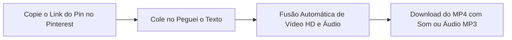
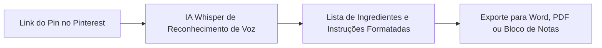

Aprender **como baixar vídeo do Pinterest** é uma das buscas que mais cresce entre entusiastas de design, culinária, artesanato, moda e organização pessoal. O **Pinterest** transformou-se no maior catálogo de referências estéticas e ideias práticas do planeta: são milhões de receitas em vídeo, tutoriais de faça você mesmo (*DIY*), rotinas de treino, maquiagens artísticas, animações inspiradoras e cortes de tendências para criadores de conteúdo.

No entanto, quem tenta salvar essas produções diretamente pelo aplicativo depara-se com uma limitação frustrante: enquanto para fotos estáticas o Pinterest oferece o botão "Baixar imagem", **para vídeos a plataforma só disponibiliza a opção de "Salvar na pasta / painel" da sua conta**. Isso significa que o arquivo de vídeo (.mp4) não é transferido para a galeria do seu celular nem para o disco do computador, impedindo que você assista offline ou edite o material.

Para piorar, quem tenta pesquisar por *"baixar vídeo do Pinterest"* na internet depara-se com um duplo problema:
1. **Vídeos mudos (sem som)**: A esmagadora maioria dos conversores online entrega o arquivo de vídeo sem a trilha sonora original.
2. **Propagandas maliciosas**: Páginas inseguras com popups falsos de vírus, botões enganosos e notificações invasivas.

Neste **guia definitivo e atualizado para 2026**, você vai aprender o passo a passo seguro para **baixar vídeo do Pinterest com áudio** em alta resolução (**MP4 Full HD**), entender como salvar no celular (Android e iPhone) e no PC, e descobrir como a Inteligência Artificial pode extrair a lista de ingredientes ou instruções de qualquer vídeo em segundos.

---

## O Grande Mistério: Por Que os Baixadores Comuns Entregam Vídeos do Pinterest Sem Som?

Se você já tentou utilizar baixadores genéricos da internet para salvar um vídeo do Pinterest, é quase certo que já passou pela decepção de abrir o arquivo na sua galeria e perceber que **o áudio simplesmente desapareceu**.

### A Razão Técnica:
O Pinterest utiliza uma tecnologia avançada de entrega de mídia chamada **HLS (HTTP Live Streaming)**. Para economizar consumo de dados e permitir que o feed role sem travamentos, os servidores do Pinterest dividem as mídias em duas trilhas separadas:
* Uma trilha apenas de **vídeo** (geralmente transmitida em fragmentos `.ts` ou arquivo `.mp4` mudo);
* Uma trilha separada apenas de **áudio** (comprimida em formato `.m4a`).

A maioria dos conversores piratas antigos da web simplesmente captura o primeiro fluxo de vídeo que encontra na página e o entrega ao usuário, ignorando completamente a trilha de som.

> **Diferencial Peguei o Texto**: O motor em nuvem do [Peguei o Texto](/baixar-video) reconhece automaticamente as duas trilhas independentes do Pinterest, realiza a multiplexação (junção perfeita de áudio e vídeo em alta definição) e entrega o **MP4 Full HD com som 100% sincronizado e cristalino**.

---

## Os Perigos dos Conversores Piratas de Pinterest (ExpertsPHP, Catchvideo e Clones)

Ao procurar por ferramentas para baixar vídeos de pins, é comum cair em sites antigos ou clones cheios de práticas abusivas:

1. **Popups de Notificações Enganosas**: Janelas suspensas que travam a tela com mensagens como: *"Permita as notificações para iniciar o download do Pin"*. Se você clicar em "Permitir", seu celular ou computador passará a receber notificações constantes de golpes financeiros, cassinos e falsos alertas de malware.
2. **Botões de Download Falsos**: A tela é preenchida por botões chamativos nas cores verde ou azul com termos como *"Download Now"*. Na prática, quase todos são anúncios disfarçados que levam você para páginas de cadastro de celular ou downloads suspeitos.
3. **Instalação de Extensões Duvidosas**: Vários sites tentam forçar o usuário a adicionar extensões no navegador Chrome com a promessa de "ativar a qualidade HD", o que pode comprometer a privacidade das suas senhas e dados de navegação.

---

## Método 1: Baixar Vídeos do Pinterest com Áudio no Peguei o Texto (Recomendado e Grátis)

A forma mais rápida, segura e moderna para baixar vídeos e animações do Pinterest em **MP4 Full HD com áudio completo** ou extrair apenas a faixa de música/locução em **MP3** é através do [Peguei o Texto](/baixar-video).

O serviço é 100% gratuito, não exige cadastro para downloads simples e suporta tanto links curtos gerados no app (`pin.it`) quanto links diretos de desktop (`pinterest.com/pin/...`).



### Passo a passo para baixar:
1. Abra o aplicativo do **Pinterest** no seu smartphone ou acesse o site no computador.
2. Abra o vídeo que deseja salvar.
3. Clique ou toque no ícone de **Compartilhar** (setinha ou ícone de envio) e selecione **"Copiar link"**.
4. Acesse o [Baixador de Vídeos do Peguei o Texto](/baixar-video) no seu navegador.
5. Cole a URL no campo de busca e clique em **"Buscar Vídeo"**.
6. O sistema identificará o Pin imediatamente e apresentará os botões: **"Baixar Vídeo (MP4 HD)"** (com áudio integrado) e **"Baixar Áudio (MP3)"**.
7. Clique no botão desejado: o arquivo será salvo na hora, sem nenhum redirecionamento suspeito!

---

## Método 2: Como Baixar Vídeo do Pinterest no Celular (Android e iPhone)

Como mais de 80% da navegação no Pinterest é realizada em celulares, veja o procedimento exato para cada sistema operacional:

### No Celular Android:
1. No app do Pinterest, abra o vídeo desejado.
2. Toque no ícone de **três pontinhos (...)** no canto superior direito do Pin (ou no botão de **Compartilhar** no canto inferior) e escolha **"Copiar link"**.
3. Abra o navegador **Chrome** ou **Samsung Internet** e acesse [pegueiotexto.com.br/baixar-video](/baixar-video).
4. Cole o link do Pin e clique em **"Buscar Vídeo"**.
5. Toque em **"Baixar Vídeo (MP4 HD)"**.
6. O arquivo será salvo na pasta **Downloads** do seu smartphone e aparecerá automaticamente na sua **Galeria** ou no app **Google Fotos**.

### No iPhone e iPad (iOS):
No ecossistema da Apple, o gerenciador de downloads do **Safari** garante máxima privacidade:
1. No app do Pinterest, toque no ícone de **Compartilhar** do Pin e escolha **"Copiar link"**.
2. Abra o **Safari** e entre no [Peguei o Texto](/baixar-video).
3. Cole o link no campo de busca e toque em **"Baixar Vídeo (MP4 HD)"**.
4. O Safari exibirá um aviso: *"Deseja baixar este arquivo?"* — confirme tocando em **"Baixar"**.
5. Toque no ícone azul de downloads ao lado da barra de endereços do Safari, selecione o vídeo baixado, toque no botão de **Compartilhar** (quadrado com seta para cima) e escolha **"Salvar Vídeo"**.
6. O vídeo com som impecável será gravado diretamente no rolo da câmera do seu aplicativo **Fotos**!

---

## Método 3: Como Baixar Vídeo do Pinterest no Computador (Windows e Mac)

Para designers, editores de vídeo e profissionais de artesanato que usam programas como Premiere Pro, Canva ou Photoshop no computador:

1. Acesse o [Pinterest](https://www.pinterest.com) no navegador do seu PC ou Mac.
2. Clique no Pin que contém o vídeo para abrir a página da publicação.
3. Copie o endereço completo da barra de navegação (ex: `https://www.pinterest.com/pin/123456789...`) ou clique no ícone de compartilhar do Pin e selecione **"Copiar link"**.
4. Abra a ferramenta de [Download do Peguei o Texto](/baixar-video).
5. Cole o link com `Ctrl + V` (Windows) ou `Cmd + V` (Mac) e clique em **"Buscar Vídeo"**.
6. Clique em **"Baixar Vídeo (MP4 HD)"** para transferir o arquivo na melhor resolução disponível para a pasta que preferir.

---

## Método 4: Como Baixar GIFs e Animações do Pinterest

O Pinterest possui uma infinidade de GIFs animados de alta qualidade para stickers, memes e apresentações corporativas.

### Como funciona a extração de GIFs:
Da mesma forma que outras redes sociais modernas, o Pinterest converte arquivos `.gif` pesados em pequenos loops de vídeo em formato MP4 para carregamento rápido.

Ao colar o link de um Pin de GIF no [Peguei o Texto](/baixar-video), o sistema detecta a mídia e permite que você faça o download do arquivo MP4 com tamanho otimizado. Se você precisar do arquivo final na extensão tradicional `.gif`, basta utilizar qualquer conversor simples de MP4 para GIF no navegador.

---

## Método 5: yt-dlp para Pinterest (A Opção Open-Source para Usuários Avançados)

Para engenheiros de software, arquivistas digitais e quem trabalha com automações em Python, o utilitário de terminal **yt-dlp** suporta links do Pinterest com extração nativa de áudio e vídeo via FFmpeg:

```bash
# Baixar o vídeo do Pinterest com mesclagem automática de som em MP4
yt-dlp -f "bestvideo+bestaudio/best" --merge-output-format mp4 "https://www.pinterest.com/pin/123456789/"
```

O *yt-dlp* resolve tanto links diretos de pins quanto links curtos do tipo `pin.it`. Para uso diário sem ter que abrir o terminal, a interface visual do Peguei o Texto entrega o mesmo resultado com apenas dois cliques no navegador.

---

## Tabela Comparativa: Melhores Formas de Baixar Vídeo do Pinterest em 2026

| Método / Ferramenta | Qualidade Máxima | Baixa com Áudio (Som)? | Sem Popups Maliciosos? | Aceita Links pin.it? | Extrai Áudio MP3? | Transcreve com IA? |
| :--- | :--- | :--- | :--- | :--- | :--- | :--- |
| 🚀 **[Peguei o Texto](/baixar-video)** | **MP4 Full HD (1080p)** | **Sim (100% Sincronizado)** | **Sim (Zero Anúncios)** | **Sim** | **Sim (1 Clique)** | **Sim (Whisper IA)** |
| 📱 **App Oficial do Pinterest** | Não salva arquivo MP4 | Apenas assiste online | Sim | Sim | Não | Não |
| 🌐 **Sites Piratas (ExpertsPHP / Clones)** | 480p / 720p | Não (Geralmente mudo) | Não (Dezenas de popups) | Parcial | Limitado | Não |
| 💻 **yt-dlp (Linha de Comando)** | Full HD Original | Sim (Exige FFmpeg) | Sim | Sim | Sim | Não |

---

## O Segredo dos Criadores: Transcrever Receitas e Tutoriais do Pinterest com IA

Baixar o vídeo do Pinterest é incrível para guardar referências visuais, mas e quando o Pin é uma **receita culinária rápida** ou um **passo a passo detalhado de artesanato e reforma (DIY)**?

Você com certeza já passou pela chatice de:
* Ficar pausando o vídeo a cada 3 segundos com a mão suja de massa de bolo para anotar a quantidade de farinha;
* Ter que assistir a gravação 10 vezes para tentar ler o nome de um produto que apareceu rapidamente na tela;
* Tentar copiar o passo a passo falado pelo criador em um caderno de notas.

Em vez de perder tempo com anotações manuais, você pode utilizar a ferramenta de [Transcrever Vídeo](/transcrever-video-em-texto-online-gratis) do Peguei o Texto:



A Inteligência Artificial analisa toda a locução e instruções do vídeo, transcreve com pontuação impecável e organiza as falas em parágrafos claros. Você pode copiar a lista de ingredientes ou instruções diretamente para o seu bloco de notas ou exportar em **Word (.docx)** e **PDF**!

*(Aproveite para conferir nossos tutoriais completos sobre [como baixar vídeo do Instagram Reels](/blog/como-transcrever-video-guia-definitivo), [como baixar vídeo do TikTok sem marca d'água](/blog/baixar-video-tiktok) e [como baixar vídeo do YouTube em alta qualidade](/blog/baixar-video-do-youtube)).*

---

## Aspectos Legais e Boas Práticas ao Salvar Mídias do Pinterest

* **Uso Pessoal e Inspiração**: Baixar vídeos para guardar como pasta de referências de decoração, receitas para cozinhar em casa ou exercícios para a sua rotina fitness pessoal é uma prática legítima e segura.
* **Respeito aos Criadores**: Se você for utilizar trechos de vídeos do Pinterest para criar vídeos de reação, análises ou montar moodboards públicos em redes sociais, sempre mencione e dê os créditos ao perfil do criador original. Nunca republique conteúdos autorais fingindo ser o produtor da mídia.

---

## Perguntas Frequentes (FAQ)

### 1. Por que os vídeos do Pinterest costumam baixar sem som em outros sites?
O Pinterest armazena o fluxo de vídeo e o fluxo de áudio em arquivos técnicos separados para economizar largura de banda nos celulares. A maioria dos sites piratas só copia a trilha de imagem. O [Peguei o Texto](/baixar-video) reúne e sincroniza as duas trilhas nos servidores em nuvem, entregando o vídeo completo com som estéreo.

### 2. A ferramenta funciona com links curtos do tipo `pin.it`?
Sim! O Peguei o Texto aceita tanto links curtos do tipo `https://pin.it/...` (gerados ao clicar no botão de compartilhar do app do celular) quanto URLs completas de computador do tipo `https://br.pinterest.com/pin/...`.

### 3. Onde o vídeo do Pinterest é salvo no meu celular?
No Android, o vídeo vai direto para a pasta **Downloads** e é catalogado automaticamente na sua **Galeria** ou no app **Google Fotos**. No iPhone (iOS), após o download no Safari, toque no ícone de compartilhamento do arquivo e selecione *"Salvar Vídeo"* para transferi-lo para o app **Fotos**.

### 4. Preciso ter conta ou estar logado no Pinterest para conseguir baixar?
Não. Para vídeos públicos, você só precisa do link do Pin. Não é necessário fazer login nem fornecer seus dados para realizar o download.

### 5. Consigo extrair apenas a música ou áudio em MP3 de um vídeo do Pinterest?
Sim! Ao colar o link no Peguei o Texto, basta selecionar a opção **"Baixar Áudio (MP3)"**. O sistema isola a faixa acústica com alta fidelidade sem que você precise carregar o arquivo de vídeo inteiro.

---

## Conclusão: Salve Vídeos do Pinterest com Áudio e Qualidade Máxima

Baixar seus vídeos preferidos do Pinterest não precisa ser um processo frustrante com arquivos mudos, telas travadas e anúncios invasivos. Com ferramentas modernas e gratuitas como o [Peguei o Texto](/baixar-video), você salva seus tutoriais, receitas e inspirações em MP4 Full HD com áudio original em poucos segundos.

E se você quiser transformar instruções culinárias ou tutoriais falados em um texto prático de consulta rápida, aproveite a Inteligência Artificial integrada para transcrever o conteúdo com precisão total.

Experimente agora o [Baixador de Mídias do Peguei o Texto](/baixar-video) e guarde as melhores ideias da internet direto no seu dispositivo!
