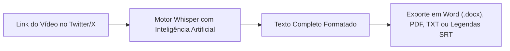

Aprender **como baixar vídeo do Twitter** (atualmente chamado de **X**) é uma das necessidades mais frequentes dos internautas. O Twitter/X consolidou-se como o verdadeiro termômetro do mundo em tempo real: é lá que surgem as notícias de última hora (*breaking news*), os memes que viralizam em poucas horas, as entrevistas polêmicas, lances de futebol históricos e debates aprofundados sobre tecnologia e finanças.

No entanto, quem utiliza a plataforma diariamente esbarra em uma enorme frustração: **o Twitter/X não possui um botão nativo para salvar vídeos (.mp4) na galeria do celular ou no disco rígido do computador**. O botão de "Salvar" dentro do app apenas adiciona o tweet à sua lista interna de itens salvos (*bookmarks*), que depende de conexão com a internet e pode desaparecer caso o autor original apague o post ou tenha a conta suspensa.

Além disso, quem recorre ao Google para pesquisar *"baixar vídeo do Twitter"* ou *"download video twitter"* costuma cair em páginas infestadas de propagandas duvidosas, popups de falsos vírus que travam o navegador e links enganosos que tentam instalar softwares indesejados.

Neste **guia definitivo e atualizado para 2026**, você vai aprender o passo a passo seguro para **baixar vídeo do Twitter** em alta definição (**MP4 Full HD**), entender como salvar os famosos GIFs da rede em formato de vídeo e descobrir como extrair o áudio e as transcrições das falas com Inteligência Artificial em segundos.

---

## O Desafio da Transição: Links do Twitter.com vs. X.com

Desde que a rede social passou pelo processo de reformulação visual e institucional de **Twitter** para **X**, os endereços de compartilhamento sofreram alterações técnicas:

* Links clássicos: `https://twitter.com/usuario/status/123456789...`
* Links atuais: `https://x.com/usuario/status/123456789...`

Muitos baixadores e conversores antigos da internet pararam de funcionar ou passaram a apresentar falhas de conexão constantes porque não atualizaram seus sistemas para reconhecer o domínio `x.com`. 

> **Compatibilidade Total**: Ferramentas modernas de extração em nuvem, como o **Peguei o Texto**, identificam e resolvem automaticamente qualquer variação de link (`twitter.com`, `x.com` ou links encurtados `t.co`), garantindo que seu download ocorra sem interrupções.

---

## Os Perigos Ocultos dos Conversores Piratas de Twitter (TWDown, SSSTwitter e Clones)

Ao digitar termos como "Twitter video download" no navegador, a maioria dos usuários se depara com clones de ferramentas que já foram populares no passado, como TWDown, SaveTweetVid ou SSSTwitter. No entanto, essas páginas sobrevivem à base de modelos publicitários extremamente predatórios:

1. **Sequestro de Notificações do Navegador**: O site bloqueia a tela e exige que você clique em *"Permitir"* para liberar o arquivo. Isso autoriza o envio de centenas de notificações com falsos avisos de segurança (*"Seu iPhone/PC está danificado por vírus"*) e links de cassinos online.
2. **Botões de Download Trapaceiros**: A interface costuma ser desenhada com botões falsos e chamativos de *"Baixar Agora"* ou *"Start Download"*. Ao clicar, você é redirecionado para abas de apostas ou páginas de phishing em vez de obter seu vídeo.
3. **Instalação de Extensões Maliciosas**: Determinadas páginas induzem o usuário a instalar extensões no Google Chrome sob o pretexto de "ativar o acelerador de download", que passam a monitorar sua navegação e injetar propagandas em outros sites.
4. **Degradação de Resolução**: Para economizar custos de servidor, vários conversores gratuitos comprimem o vídeo original, entregando imagens pixeladas em 360p ou 480p, mesmo quando o autor publicou a mídia em 1080p Full HD.

---

## Método 1: Baixar Vídeos do Twitter (X) Online no Peguei o Texto (Recomendado e Seguro)

A forma mais prática, segura e livre de anúncios invasivos para baixar vídeos e clipes do Twitter/X em **MP4 Full HD** ou extrair a faixa sonora em **MP3** é através do [Peguei o Texto](/baixar-video).

O sistema processa a URL diretamente nos servidores em nuvem, eliminando scripts maliciosos de intermediários publicitários e entregando o arquivo limpo em altíssima velocidade.


### Como usar o baixador online:
1. Acesse o **Twitter/X** no seu aplicativo ou navegador web.
2. No tweet com o vídeo que deseja salvar, clique ou toque no botão de **Compartilhar** (ícone de seta para cima ou no símbolo de compartilhamento).
3. Selecione a opção **"Copiar link"** (seja ele `x.com` ou `twitter.com`).
4. Abra o [Baixador de Vídeos do Peguei o Texto](/baixar-video) no seu navegador.
5. Cole o link no campo de texto e clique em **"Buscar Vídeo"**.
6. O sistema identificará o conteúdo em menos de 2 segundos e exibirá as opções: **"Baixar Vídeo (MP4 HD)"** e **"Baixar Áudio (MP3)"**.
7. Clique no formato escolhido e o arquivo será transferido diretamente para a sua pasta de downloads!

---

## Método 2: Como Baixar Vídeo do Twitter no Celular (Android e iPhone)

O consumo de conteúdo no Twitter/X ocorre massivamente em dispositivos móveis. Veja como salvar vídeos na galeria tanto no Android quanto no iPhone/iPad.

### No Celular Android:
1. Abra o app do Twitter/X no seu celular.
2. Localize o vídeo desejado e toque no ícone de **Compartilhar** abaixo do tweet.
3. Toque em **"Copiar link"**.
4. Abra o navegador **Chrome**, **Samsung Internet** ou **Brave** e acesse [pegueiotexto.com.br/baixar-video](/baixar-video).
5. Cole a URL no campo de busca e confirme.
6. Toque no botão **"Baixar Vídeo (MP4 HD)"**.
7. O vídeo será baixado diretamente para a pasta **Downloads** e ficará visível instantaneamente na **Galeria** do celular ou no app **Google Fotos**, pronto para ser enviado no WhatsApp ou postado no Instagram Stories/Reels.

### No iPhone e iPad (iOS):
No sistema iOS, o navegador nativo **Safari** possui um gerenciador de downloads limpo e muito eficiente:
1. No app do X (Twitter), toque no botão de compartilhar do tweet e escolha **"Copiar link"**.
2. Abra o **Safari** e acesse o [Peguei o Texto](/baixar-video).
3. Cole a URL e toque em **"Baixar Vídeo (MP4 HD)"**.
4. O Safari exibirá uma janela de confirmação: toque em **"Baixar"**.
5. Um ícone azul de download aparecerá ao lado da barra de navegação superior. Toque nele, abra o arquivo baixado, clique no botão de **Compartilhar** (quadrado com seta para cima) e selecione **"Salvar Vídeo"**.
6. O vídeo em alta definição será salvo diretamente no rolo da câmera do aplicativo **Fotos** do seu iPhone!

---

## Método 3: Como Baixar Vídeo do Twitter no Computador (Windows e Mac)

Se você trabalha como redator, social media, analista político ou criador de conteúdo no desktop:

1. Acesse o [X (Twitter)](https://x.com) pelo navegador no seu computador.
2. No tweet contendo o vídeo, clique no ícone de **Compartilhar** e selecione **"Copiar link do post"** (ou simplesmente copie a URL diretamente da barra de endereços do navegador).
3. Abra o [Baixador de Vídeos do Peguei o Texto](/baixar-video).
4. Cole o link com o atalho `Ctrl + V` (Windows) ou `Cmd + V` (Mac) e clique em **"Buscar Vídeo"**.
5. Clique em **"Baixar Vídeo (MP4 HD)"** e escolha a pasta do seu computador onde deseja guardar o arquivo.

---

## Método 4: Como Baixar GIFs do Twitter em Vídeo MP4

Uma das maiores dúvidas dos usuários do Twitter é: *"Por que quando tento baixar um GIF do Twitter ele é salvo como vídeo?"*

### A Verdade Técnica sobre os GIFs do Twitter:
Arquivos com a extensão `.gif` tradicional são formatos pesados criados nos anos 1980 que consomem dezenas de vezes mais largura de banda que um vídeo comprimido moderno. Para economizar servidores e permitir que a sua timeline carregue de forma instantânea, o **Twitter converte automaticamente todos os GIFs enviados em pequenos vídeos MP4 em loop sem som**.

Ao utilizar o [Peguei o Texto](/baixar-video):
1. Copie o link do tweet que contém o GIF.
2. Cole no campo de busca da ferramenta.
3. O sistema reconhece a mídia e permite que você baixe o arquivo `.mp4` leve em altíssima qualidade.
4. Se você precisar do arquivo em formato `.gif` tradicional para colocar em apresentações do PowerPoint ou figurinhas, basta converter o MP4 baixado utilizando conversores online rápidos em um clique.

---

## Método 5: yt-dlp para Twitter/X (A Opção Open-Source para Usuários Avançados)

Para programadores, desenvolvedores e pesquisadores que realizam mineração de dados ou arquivamento em lote, a ferramenta de terminal de código aberto mais robusta do mundo é o **yt-dlp**:

```bash
# Baixar o vídeo do Twitter/X na melhor qualidade de áudio e vídeo
yt-dlp -f "best" "https://x.com/usuario/status/1234567890"
```

O *yt-dlp* resolve tanto links antigos `twitter.com` quanto os novos `x.com`. Ele é executado pelo terminal sem anúncios, sendo a engine recomendada para quem deseja criar scripts automatizados em Python ou Bash. Para a grande maioria das pessoas que buscam facilidade no dia a dia, porém, o uso da interface web do Peguei o Texto resolve o problema sem necessidade de configurar terminais ou bibliotecas.

---

## Tabela Comparativa: As Melhores Ferramentas para Baixar Vídeo do Twitter em 2026

| Ferramenta / Método | Qualidade Máxima | Popups / Anúncios Invasivos? | Risco de Vírus? | Salva GIFs em MP4? | Extrai Áudio MP3? | Transcreve com IA? |
| :--- | :--- | :--- | :--- | :--- | :--- | :--- |
| 🚀 **[Peguei o Texto](/baixar-video)** | **MP4 Full HD (1080p)** | **Zero Popups** | **Zero Risco** | **Sim** | **Sim (1 Clique)** | **Sim (Whisper IA)** |
| 🌐 **Sites Piratas (TWDown / SSSTwitter)** | 720p / Comprimido | Dezenas de anúncios | Alto (Phishing) | Parcial | Limitado | Não |
| 🤖 **Bots do Telegram** | Variável | Notificações de spam | Médio | Sim | Raro | Não |
| 💻 **yt-dlp (Linha de Comando)** | Full HD Original | Zero Anúncios | Zero Risco | Sim | Sim (com FFmpeg) | Não |

---

## O Segredo dos Criadores e Jornalistas: Transcrever Vídeos do Twitter com IA

Muitas vezes, salvar o arquivo de vídeo do Twitter é apenas a primeira etapa do seu trabalho. O que você realmente precisa para o seu dia a dia é do **conteúdo verbal falado na gravação**:

* **Jornalistas e Pesquisadores**: Extrair a declaração exata de uma autoridade pública em uma coletiva transmitida no X para compor uma matéria;
* **Criadores de Conteúdo**: Pegar o roteiro de um corte viral do Twitter para transformar em carrossel no Instagram ou post no LinkedIn;
* **Estudantes e Curiosos**: Obter o resumo em tópicos de uma explicação complexa sobre tecnologia, investimentos ou geopolítica;
* **Editores de Vídeo**: Criar legendas sincronizadas em `.srt` para legendar o corte no CapCut ou Premiere Pro.

Em vez de perder 20 minutos ouvindo o vídeo, pausando a cada duas palavras e digitando manualmente, você pode utilizar a ferramenta de [Transcrever Vídeo](/transcrever-video-em-texto-online-gratis) do Peguei o Texto:



Com apenas um clique, a Inteligência Artificial decodifica todo o áudio do vídeo, separa em parágrafos organizados com pontuação gramatical impecável e permite exportar o texto formatado para **Word (.docx)**, **PDF** ou **TXT**.

*(Aproveite para ver também nossos tutoriais completos sobre [como baixar vídeo do YouTube](/blog/baixar-video-do-youtube), [como baixar vídeo do TikTok sem marca d'água](/blog/baixar-video-tiktok) e [como gerar legendas SRT sincronizadas](/blog/como-gerar-legendas-srt-para-videos-do-youtube-e-tiktok)).*

---

## Aspectos Legais e Boas Práticas ao Salvar Mídias do Twitter

* **Uso Pessoal e Educacional**: Baixar um vídeo para assistir offline, salvar um tutorial prático ou guardar uma lembrança pessoal de um tweet de sua autoria é plenamente legítimo.
* **Citação e Direitos Autorais**: Ao reutilizar vídeos públicos de terceiros para comentários ou análises críticas (*fair use*), marque sempre o perfil do autor original no tweet ou vídeo derivado. Nunca republique trabalhos artísticos ou jornalísticos sem dar os devidos créditos.
* **Tweets de Contas Privadas (Cadeado)**: Nenhum baixador online público tem autorização para acessar mídias postadas por contas fechadas no Twitter/X que exigem aprovação de seguidor. Respeite sempre a privacidade dos usuários.

---

## Perguntas Frequentes (FAQ)

### 1. É seguro baixar vídeo do Twitter pelo celular?
Sim, desde que você utilize um serviço online que funcione 100% no navegador e não solicite a instalação de aplicativos desconhecidos (`.apk` no Android ou certificados de gerenciamento no iPhone). O [Peguei o Texto](/baixar-video) processa a mídia na nuvem sem acessar dados privados do seu aparelho.

### 2. Por que alguns vídeos do Twitter demoram para carregar no baixador?
Se o tweet tiver acabado de ser publicado, os servidores do Twitter/X podem levar alguns segundos para processar e codificar os diferentes níveis de resolução (360p, 720p, 1080p). Aguarde cerca de 1 minuto após a publicação do tweet para obter a qualidade máxima.

### 3. A ferramenta funciona com links que começam com `x.com` e `twitter.com`?
Sim! O sistema do Peguei o Texto suporta nativamente tanto o domínio clássico `twitter.com` quanto o domínio moderno `x.com`, além de links encurtados móveis do tipo `t.co`.

### 4. Consigo salvar vídeos de transmissões ao vivo (Spaces ou Lives) do Twitter?
Se a transmissão ao vivo ou gravação do Spaces já tiver sido finalizada e o autor disponibilizou a reprise no tweet, você consegue baixar o áudio ou vídeo normalmente através do link.

### 5. Consigo extrair apenas a faixa de áudio em MP3 de um vídeo do Twitter?
Sim! Basta colar o link da publicação no [Peguei o Texto](/baixar-video) e selecionar o botão **"Baixar Áudio (MP3)"**. O conversor extrai a trilha sonora com alta definição sem que você precise carregar o arquivo pesado de vídeo.

---

## Conclusão: Baixe Vídeos do Twitter (X) com Rapidez e Sem Complicações

Baixar vídeos e GIFs do Twitter/X não precisa ser uma experiência desagradável cheia de redirecionamentos suspeitos e notificações de vírus falsos. Com plataformas seguras e modernas como o [Peguei o Texto](/baixar-video), você baixa seus vídeos em MP4 Full HD e extrai faixas de áudio em MP3 de forma simples, direta e segura.

E se o seu objetivo for estudar, trabalhar ou criar conteúdo a partir das informações ditas no vídeo, dê um passo além: transforme qualquer fala em **texto digitado e atas estruturadas com IA** em menos de um minuto.

Experimente agora mesmo o [Baixador e Transcritor do Peguei o Texto](/baixar-video) e tenha total controle sobre os vídeos da internet!
