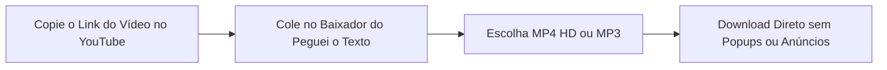

Aprender **como baixar vídeo do YouTube** é uma das buscas mais populares da internet. Seja para assistir a aulas em viagens sem sinal de internet, arquivar tutoriais indispensáveis no computador, baixar gravações ou estudar palestras sem depender de conexões instáveis, ter o arquivo de mídia salvo traz enorme conveniência.

No entanto, quem faz essa pesquisa no Google costuma cair em um verdadeiro campo minado: mais de **90% dos sites gratuitos de download de vídeos** estão tomados por anúncios abusivos, popups com notificações falsas (*"Seu computador foi infectado por vírus!"*), scripts invasivos de rastreamento e instaladores com programas potencialmente indesejados (*adwares* e *bloatwares*).

Para proteger sua segurança digital e poupar seu tempo, preparamos este **guia definitivo para 2026**. Aqui você vai conhecer os **métodos mais seguros e testados para baixar vídeos do YouTube** no PC, Mac e smartphone, aprender a se proteger contra armadilhas virtuais e descobrir uma solução inovadora: **você realmente precisa do arquivo pesado de vídeo ou só quer as informações ditas nele?**

---

## O Alerta de Segurança: Os Perigos Ocultos dos Conversores Gratuitos

Antes de clicar no primeiro resultado que promete "download grátis em 1 clique", vale entender como a maioria dos sites piratas de download opera:

1. **Popups de Notificações Enganosas**: Quase todos os conversores antigos exibem uma janela suspensa solicitando que você clique em *"Permitir"* para liberar o download. Ao fazer isso, você autoriza o site a disparar notificações intrusivas diretamente na tela do seu computador ou celular, promovendo falsos antivírus, apostas e páginas maliciosas.
2. **Botões de Download Falsos**: A página costuma ser diagramada com dezenas de botões verdes ou vermelhos escritos *"Baixar Agora"* ou *"Start Download"*, que na verdade são banners publicitários disfarçados. O botão real do arquivo fica oculto, minúsculo ou com temporizadores forçados.
3. **Instaladores com Adwares e Spywares**: Certos conversores exigem que você baixe um arquivo `.exe` ou instale uma extensão desconhecida no navegador. Esses softwares podem sequestrar sua página inicial, injetar propagandas no seu navegador e coletar seu histórico de navegação.

> **Regra de Ouro**: Jamais execute instaladores `.exe` ou aceite notificações de navegador para liberar downloads de vídeos. Se o site exigir instalação de softwares desconhecidos, feche a aba imediatamente.

---

## Método 1: Baixar Vídeos do YouTube Online com Segurança no Peguei o Texto (Recomendado)

Se você procura um conversor online que funcione direto no navegador, sem precisar instalar programas e, acima de tudo, **sem popups enganosos, propagandas falsas ou risco de vírus**, a solução mais moderna é o [Baixador de Vídeos do YouTube do Peguei o Texto](/baixar-video-youtube).

Desenvolvido para oferecer uma experiência limpa e segura, o serviço permite salvar vídeos normais e **YouTube Shorts** em alta definição (**MP4 HD**) ou extrair a faixa de áudio em **MP3** de forma 100% gratuita.



### Como usar o baixador online:
1. Abra o YouTube (no aplicativo ou no computador), clique em **Compartilhar** no vídeo desejado e selecione **"Copiar Link"**.
2. Acesse a ferramenta gratuita de [Baixar Vídeo do YouTube](/baixar-video-youtube).
3. Cole a URL no campo de busca e clique em **"Buscar Vídeo"**.
4. O sistema identificará o vídeo instantaneamente. Escolha se deseja baixar em **Vídeo (MP4 HD)** ou **Áudio (MP3)**.
5. Pronto! O download é iniciado direto no seu dispositivo, sem redirecionamentos para outras páginas.

*Diferencial Exclusivo*: Se você estiver baixando o vídeo para estudar ou trabalhar, o Peguei o Texto oferece um botão exclusivo para **transcrever o vídeo em texto com Inteligência Artificial** em menos de 1 minuto!

---

## Método 2: YouTube Premium (O Método Oficial e 100% Legal)

A alternativa oficial recomendada pelo Google para assistir a vídeos do YouTube offline é a assinatura do **YouTube Premium**.

### Como funciona:
O YouTube disponibiliza um botão nativo de download diretamente no aplicativo (Android e iOS) e nas versões web dos navegadores Chrome, Edge e Firefox para assinantes:

1. Acesse o vídeo desejado no aplicativo do YouTube ou no navegador do computador.
2. Clique no botão **"Download"** (localizado logo abaixo do player, entre os botões de curtir e compartilhar).
3. Escolha a resolução desejada (até 1080p Full HD).
4. O vídeo será baixado diretamente para a aba **"Downloads"** da sua biblioteca.

### Prós e Contras do YouTube Premium:
* **Vantagens**: 100% legal, zero risco de segurança, remove todos os anúncios da plataforma, suporta reprodução com a tela do celular apagada e inclui o streaming do YouTube Music.
* **Limitações**: O arquivo de vídeo fica criptografado dentro do aplicativo e **não pode ser exportado como um arquivo `.mp4` independente** para ser editado no Premiere, CapCut ou compartilhado no WhatsApp. Exige mensalidade ativa e requer conexão à internet pelo menos uma vez a cada 30 dias para revalidar os arquivos.

---

## Método 3: VLC Media Player (Gratuito, Seguro e Sem Instalar Nada Suspeito)

O **VLC**, o reprodutor de mídia gratuito e de código aberto (*open-source*) mais consagrado do mundo, possui um recurso nativo para reproduzir e extrair o fluxo direto de vídeos do YouTube sem exibir nenhuma propaganda.

Este método é ideal para usuários de **Windows, Mac e Linux**:

### Passo a passo no VLC:
1. Copie o link do vídeo do YouTube que você deseja salvar.
2. Abra o **VLC Media Player** no seu computador.
3. No menu superior, clique em **Mídia** (no Windows) ou **Arquivo** (no Mac) e escolha **"Abrir Transmissão de Rede..."** (atalho: `Ctrl + N` no Windows ou `Cmd + N` no Mac).
4. Cole o link do YouTube no campo de URL e clique em **"Reproduzir"**.
5. O vídeo começará a tocar dentro do VLC. Enquanto ele reproduz, vá no menu **Ferramentas** > **Informações sobre o Codec** (atalho: `Ctrl + I` no Windows ou `Cmd + I` no Mac).
6. Na parte inferior da janela aberta, localize o campo chamado **"Localização"**. Dê um clique duplo nessa linha comprida de código e copie o link completo (`Ctrl + C`).
7. Abra seu navegador web, cole esse link na barra de endereços e aperte `Enter`.
8. O vídeo será exibido em tela cheia direto do servidor do Google. Basta clicar com o botão direito sobre a imagem e selecionar **"Salvar vídeo como..."** para baixar o arquivo `.mp4` original em alta velocidade!

---

## Método 4: yt-dlp (A Ferramenta Mais Poderosa para Criadores e Desenvolvedores)

Se você precisa baixar vídeos em **4K**, **1080p a 60 FPS**, arquivar playlists completas ou extrair apenas faixas de áudio na máxima fidelidade sonora, a melhor ferramenta do mundo chama-se **yt-dlp**.

O *yt-dlp* é um projeto de código aberto mantido colaborativamente no GitHub, sendo a evolução atualizada do clássico *youtube-dl*. Ele roda diretamente no terminal, não contém anúncios, não coleta dados e é utilizado por profissionais de mídia e desenvolvedores.

### Como usar o yt-dlp:
1. **Instalação**:
   * No Windows: Instale facilmente pelo terminal com `winget install yt-dlp`.
   * No Mac: Instale via Homebrew com o comando `brew install yt-dlp`.
2. **Baixar o melhor vídeo em MP4**:
   Abra o Terminal ou Prompt de Comando e execute:
   ```bash
   yt-dlp -f "bestvideo[ext=mp4]+bestaudio[ext=m4a]/best[ext=mp4]" "URL_DO_VIDEO"
   ```
3. O download ocorrerá na velocidade máxima da sua conexão e salvará o arquivo na sua pasta local com o nome original do vídeo.

---

## Método 5: Como Baixar Vídeo do YouTube no Celular (Android e iPhone)

Baixar mídias no smartphone exige cuidados com armazenamento e permissões do sistema operacional:

### No Celular Android:
* **Pelo Navegador**: Acesse a ferramenta limpa do [Peguei o Texto](/baixar-video-youtube) pelo Chrome ou Brave no celular, cole o link do vídeo ou Shorts e toque em baixar MP4. O arquivo irá direto para a pasta de Downloads e aparecerá no app Galeria/Google Fotos.
* **YouTube Premium**: Para quem só deseja assistir offline sem ocupar a memória com arquivos de galeria.

### No iPhone e iPad (iOS):
O sistema da Apple possui regras rígidas para impedir que páginas da web salvem arquivos de mídia diretamente no rolo da câmera:
1. Baixe o aplicativo gratuito **Documents by Readdle** na App Store (ele conta com um gerenciador de downloads e navegador seguro embutido).
2. Abra o navegador interno do Documents e acesse o [Baixador do Peguei o Texto](/baixar-video-youtube).
3. Cole o link do YouTube e clique em baixar MP4. O arquivo será salvo na pasta "Downloads" do Documents.
4. Toque nos três pontinhos ao lado do vídeo baixado, selecione **"Compartilhar"** e escolha **"Salvar Vídeo"** para movê-lo para o aplicativo Fotos do iPhone.

---

## Você Realmente Precisa Baixar o Vídeo? (A Revolução do Conteúdo em Texto com IA)

Antes de gastar gigabytes de memória no seu computador ou celular, faça uma reflexão: **qual é o seu objetivo real ao baixar esse vídeo?**

Estudos de comportamento digital revelam que mais de **70% dos downloads de vídeos** em plataformas de estudo e trabalho têm como objetivo:
* Fazer anotações de videoaulas, cursos e palestras.
* Resumir reuniões gravadas ou conferências do setor.
* Extrair citações ou declarações de podcasts e entrevistas.
* Citar falas com precisão em teses acadêmicas, relatórios de negócios ou processos.

### O grande problema de baixar vídeos para estudar:
Um vídeo em Full HD de 1 hora consome entre **1 GB e 2 GB de armazenamento**. Além disso, após o download, você ainda precisará gastar horas assistindo, pausando a cada poucos segundos para digitar o que a pessoa falou.

### A solução inteligente: Transformar o Vídeo em Texto Estruturado
Em vez de sobrecarregar seu dispositivo com arquivos pesados de vídeo, você pode usar a ferramenta de [Transcrever Vídeo do YouTube](/transcrever-youtube) do Peguei o Texto.

Basta colar o link do YouTube: nossa Inteligência Artificial analisa o áudio diretamente na nuvem e entrega em menos de 1 minuto:
1. **Transcrição Completa**: Texto formatado com pontuação correta, parágrafos fluidos e separação de falantes.
2. **Exportação Versátil**: Baixe o documento pronto em **Word (.docx)**, **PDF** ou **TXT**.
3. **Economia de Tempo Absurda**: Ler a transcrição de um vídeo de 1 hora leva apenas **10 a 15 minutos**.
4. **Pesquisa Instantânea (`Ctrl + F`)**: Encontre qualquer número, data, nome ou conceito em uma fração de segundo.
5. **Legendas SRT**: Se você for criador de conteúdo, gere arquivos `.srt` sincronizados para legendar seus próprios vídeos (veja nosso guia de [como gerar legendas SRT para vídeos do YouTube](/blog/como-gerar-legendas-srt-para-videos-do-youtube-e-tiktok)).

Para entender o processo completo de conversão, leia também nosso tutorial detalhado sobre [como transcrever vídeo do YouTube em texto](/blog/como-transcrever-video-do-youtube-em-texto).

---

## Tabela Comparativa: Qual Método Escolher?

| Método | Nível de Segurança | Qualidade Máxima | Custo | Nível de Facilidade | Ideal Para |
| :--- | :--- | :--- | :--- | :--- | :--- |
| 🚀 **[Peguei o Texto](/baixar-video-youtube)** | **100% Seguro (Sem Popups)** | **MP4 HD / MP3** | **Grátis** | **Muito Fácil (1 Clique)** | **Quem quer baixar rápido sem vírus ou transcrever com IA** |
| 🛡️ **YouTube Premium** | Oficial (Google) | 1080p | Mensalidade | Muito Fácil | Assistir offline sem anúncios no app oficial |
| 🎬 **VLC Media Player** | 100% Seguro (Open-Source) | Qualidade original | Grátis | Média | Baixar MP4 no PC sem softwares suspeitos |
| ⚡ **yt-dlp** | 100% Seguro (Open-Source) | Até 4K / 60 FPS | Grátis | Avançada (Terminal) | Editores de vídeo, criadores e arquivistas |
| 🌐 **Sites Conversores Antigos** | ⚠️ Risco Alto de Vírus/Popups | Geralmente 720p | Grátis | Risco de cliques errados | Não recomendado |

---

## Aspectos Legais: É Crime Baixar Vídeo do YouTube?

Muitos usuários têm receio de que baixar vídeos do YouTube seja ilegal. Para esclarecer o tema, é importante separar a **Legislação Brasileira** das **Regras Comerciais da Plataforma**:

### 1. A Lei de Direitos Autorais no Brasil (Lei nº 9.610/98)
O artigo 46, inciso II, da Lei de Direitos Autorais do Brasil determina que **não constitui ofensa aos direitos autorais**:
> *"A reprodução, em um só exemplar de pequenos trechos, para uso privado do copista, desde que feita por este e sem intuito de lucro."*

Ou seja: salvar uma cópia de uma aula ou tutorial para estudar em modo offline no seu computador pessoal **não é crime nem contravenção**. No entanto, **republicar o vídeo em seu próprio canal, vendê-lo ou distribuí-lo com finalidade comercial sem autorização do autor constitui crime de violação de direitos autorais**.

### 2. Os Termos de Serviço do YouTube
As diretrizes contratuais do Google estabelecem que o usuário não deve fazer download de vídeos sem a autorização prévia por escrito ou sem utilizar as ferramentas oficiais fornecidas pelo YouTube. Portanto, utilizar ferramentas externas pode contrariar os termos de uso do serviço, mas não configura crime penal se restrito ao uso exclusivamente pessoal.

### 3. Vídeos em Domínio Público e Creative Commons
Materiais publicados com licenças abertas como **Creative Commons (CC-BY)** ou obras que já caíram em **Domínio Público** permitem o download e a reutilização legal, bastando citar os devidos créditos aos autores originais.

---

## Perguntas Frequentes (FAQ)

### 1. Como baixar apenas o áudio de um vídeo do YouTube em MP3?
Você pode utilizar o [Baixador do Peguei o Texto](/baixar-video-youtube) e selecionar a opção "Baixar Áudio em MP3". Se você precisa transformar esse áudio em um documento editável de texto para leitura, confira nosso comparativo com as [melhores ferramentas para converter MP3 em texto em 2026](/blog/melhores-ferramentas-para-converter-mp3-em-texto-2026).

### 2. Por que tantos sites de baixar vídeo do YouTube fecham ou mudam de endereço?
O YouTube atualiza frequentemente seus protocolos de entrega de mídia (*cipher scripts*) para bloquear requisições automatizadas de conversores piratas. Além disso, as associações internacionais de direitos autorais notificam constantemente os provedores de hospedagem desses sites, provocando quedas constantes.

### 3. É seguro usar extensões do Google Chrome para baixar vídeos?
Não. A loja oficial Chrome Web Store proíbe terminantemente qualquer extensão de download do YouTube para proteger os negócios de publicidade do Google. As extensões que prometem essa função precisam ser instaladas manualmente via "modo desenvolvedor", o que representa grave risco de segurança cibernética (podendo roubar senhas e dados salvos no navegador).

### 4. Como baixar vídeos do YouTube com a maior resolução possível (1080p ou 4K)?
O YouTube separa a faixa de vídeo e a faixa de áudio em resoluções superiores a 720p. Para juntar essas duas faixas sem perda de qualidade e com 60 quadros por segundo, o software livre **yt-dlp** é o padrão da indústria, unindo as trilhas em alta velocidade via FFmpeg.

### 5. Consigo transcrever qualquer vídeo do YouTube direto pelo link?
Sim! Com a plataforma de [Transcrição do Peguei o Texto](/transcrever-youtube), você não precisa baixar nenhum arquivo pesado. Basta colar o link do vídeo do YouTube para que a IA processe o áudio na nuvem e gere o texto completo, pontuado e organizado com resumo executivo em segundos.

---

## Conclusão: Baixe com Segurança e Turbine sua Produtividade

Baixar vídeos do YouTube é uma funcionalidade prática quando você precisa de acesso offline. No entanto, sua privacidade e a integridade do seu computador ou smartphone devem vir sempre em primeiro lugar. Evite sites suspeitos repletos de notificações abusivas e utilize alternativas confiáveis como o [Peguei o Texto](/baixar-video-youtube), o **YouTube Premium**, o **VLC** ou o **yt-dlp**.

E se o seu propósito for estudar, produzir resumos, redigir atas ou poupar tempo de aprendizado, considere dar o próximo passo: em vez de acumular arquivos de vídeo que ocupam gigabytes de espaço, **transforme o conteúdo falado em texto estruturado com IA**.

Acesse o [Peguei o Texto](/transcrever-youtube) gratuitamente agora mesmo e leve sua produtividade para o próximo nível!
