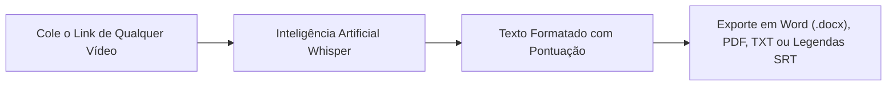

A busca por **"baixar vídeo link"** (ou *como baixar vídeo por link*) é uma das intenções de pesquisa mais recorrentes em toda a internet. Todos os dias, milhões de pessoas recebem ou encontram links de vídeos compartilhados no WhatsApp, Telegram, Slack, feeds sociais ou navegadores web e desejam apenas uma coisa simples: **colar o link em um campo de busca e salvar o arquivo de vídeo (.mp4) diretamente no celular ou no computador**.

Pode ser uma videoaula importante que você precisa assistir offline na viagem, um Reels inspirador de culinária, um meme hilário do TikTok sem marca d'água, uma palestra do YouTube ou uma matéria urgente do Twitter/X. 

No entanto, a grande maioria dos internautas esbarra em uma enorme frustração: mais de **90% das páginas que prometem "baixar vídeo por link" estão abarrotadas de anúncios fraudulentos**, popups de falsos vírus que travam a tela, botões trapaceiros de download e instaladores maliciosos de extensões que roubam dados de navegação.

Neste **guia definitivo e atualizado para 2026**, você vai aprender o método mais rápido, moderno e 100% seguro para **baixar vídeo por link** em alta definição (**MP4 Full HD**) de praticamente qualquer plataforma da web, entender como fazer isso no celular (Android e iPhone) e no PC, e conhecer um recurso revolucionário: como transformar a fala de qualquer vídeo em texto editável em menos de um minuto.

---

## Como Funciona a Tecnologia de Baixar Vídeo por Link na Nuvem?

Para compreender por que certos sites funcionam perfeitamente enquanto outros falham, vale entender a tecnologia por trás da extração de links:

Quando você assiste a um vídeo no YouTube, TikTok, Instagram ou Facebook, a plataforma não envia um arquivo simples de uma vez só. Ela utiliza protocolos avançados de streaming (como **HLS** ou **DASH**), que fatiam a mídia em pequenos pacotes de áudio e vídeo de poucos segundos para economizar largura de banda.

* **Conversores Antigos / Piratas**: Tentam capturar apenas o primeiro fragmento do navegador, resultando em vídeos corrompidos, com resolução baixa (360p) ou completamente sem áudio.
* **Plataformas Modernas em Nuvem (como o Peguei o Texto)**: Conectam-se aos servidores de distribuição da mídia original, reúnem o fluxo de vídeo Full HD e a melhor trilha de áudio estéreo, realizam a multiplexação (junção técnica) na nuvem e entregam o arquivo `.mp4` final limpo e pronto para reprodução.

> **Zero Instalação**: Você não precisa instalar programas pesados, aplicativos suspeitos nem extensões de navegador. Tudo é resolvido em segundos diretamente pela nuvem.

---

## Os Perigos dos Conversores Piratas de Link (SaveFrom, Y2Mate e Clones)

Ao pesquisar por "baixar video link" no Google, a maioria dos usuários incautos é direcionada para sites clones de conversores da década passada. Essas páginas operam com táticas predatórias:

1. **Sequestro de Notificações (*Notification Hijacking*)**: Uma janela suspensa impede o download dizendo *"Clique em Permitir para continuar"*. Ao aceitar, o site passa a bombardear seu celular ou computador com falsos alertas de vírus e propagandas de apostas online.
2. **Botões de Download Falsos**: A página exibe vários botões coloridos de *"Download Now"* ou *"Baixar Grátis"*. Na realidade, 99% deles são banners publicitários que levam para páginas de phishing ou instaladores de adwares.
3. **Limitação Forçada de Velocidade**: Vários serviços limitam intencionalmente a velocidade da sua conexão para tentar forçar a compra de assinaturas "VIP" desnecessárias.

---

## Método 1: Baixar Vídeo por Link no Peguei o Texto (Recomendado, Universal e Sem Vírus)

A melhor ferramenta para **baixar vídeo colando o link** de qualquer rede social da internet com segurança e em qualidade máxima (**MP4 Full HD** ou extração em **MP3**) é o [Peguei o Texto](/baixar-video).

O sistema conta com compatibilidade universal para mais de 1.700 plataformas e serviços de vídeo da internet, incluindo:
* **YouTube**: Vídeos longos, tutoriais e YouTube Shorts em 1080p Full HD;
* **Instagram**: Reels, publicações do feed e vídeos em alta resolução;
* **TikTok**: Vídeos em MP4 Full HD **100% sem marca d'água**;
* **Facebook**: Vídeos do Watch e Facebook Reels;
* **Twitter / X**: Vídeos de tweets e GIFs convertidos em MP4 leve;
* **Pinterest**: Pins de vídeo com áudio original completo e sincronizado;
* **LinkedIn, Vimeo, Kwai, Reddit, Twitch**: Clipes e gravações de webinars.


### Passo a passo para baixar qualquer vídeo por link:

1. Acesse o aplicativo ou site onde o vídeo está publicado (YouTube, Instagram, TikTok, etc.).
2. Clique ou toque no botão de **Compartilhar** da publicação e selecione **"Copiar link"** (ou copie a URL da barra de endereços do navegador).
3. Abra a ferramenta gratuita de [Baixar Vídeo por Link do Peguei o Texto](/baixar-video).
4. Cole o link no campo de busca central e clique em **"Buscar Vídeo"**.
5. O sistema identificará a publicação em cerca de 2 segundos e exibirá a prévia com os botões:
   * **"Baixar Vídeo (MP4 HD)"**: Salva o arquivo de imagem e som em alta fidelidade;
   * **"Baixar Áudio (MP3)"**: Extrai apenas a faixa sonora (música, podcast ou locução).
6. Clique na opção desejada e o download iniciará imediatamente no seu dispositivo, sem propagandas invasivas!

---

## Método 2: Como Baixar Vídeo por Link no Celular (Android e iPhone)

Mais de 75% das pessoas que desejam baixar vídeos a partir de links realizam o procedimento em smartphones. Veja como salvar o arquivo diretamente na galeria do seu aparelho:

### No Celular Android:
1. No app de qualquer rede social, toque em **Compartilhar** > **Copiar link**.
2. Abra o navegador **Google Chrome**, **Samsung Internet** ou **Brave** e acesse [pegueiotexto.com.br/baixar-video](/baixar-video).
3. Cole o link no campo de texto e toque em **"Buscar Vídeo"**.
4. Toque no botão **"Baixar Vídeo (MP4 HD)"**.
5. O arquivo será salvo na pasta **Downloads** do celular e ficará visível instantaneamente no app **Google Fotos** ou na sua **Galeria**.

### No iPhone e iPad (iOS):
No ecossistema Apple, o navegador nativo **Safari** possui excelente proteção e gerenciador próprio de downloads:
1. Copie o link do vídeo no aplicativo de sua preferência.
2. Abra o **Safari** e entre no [Peguei o Texto](/baixar-video).
3. Cole a URL e toque em **"Baixar Vídeo (MP4 HD)"**.
4. O Safari exibirá a mensagem de confirmação: *"Deseja baixar este arquivo?"* — confirme tocando em **"Baixar"**.
5. Toque no ícone azul com uma setinha para baixo ao lado da barra de navegação (Downloads).
6. Abra o vídeo, toque no botão de **Compartilhar** (quadrado com seta para cima) e escolha **"Salvar Vídeo"**.
7. O vídeo será transferido diretamente para o rolo da câmera no aplicativo **Fotos** do seu iPhone!

---

## Método 3: Como Baixar Vídeo por Link no Computador (Windows, Mac e Linux)

Se você trabalha com edição de vídeo, criação de conteúdo ou pesquisa no desktop:

1. No navegador do computador, abra a postagem do vídeo desejado.
2. Selecione a URL completa na barra de navegação superior e copie (`Ctrl + C` no Windows ou `Cmd + C` no Mac).
3. Acesse a página de [Download por Link do Peguei o Texto](/baixar-video).
4. Cole a URL com `Ctrl + V` (ou `Cmd + V`) e confirme a busca.
5. Clique em **"Baixar Vídeo (MP4 HD)"** e escolha a pasta do seu disco rígido onde deseja armazenar o arquivo.

---

## Método 4: yt-dlp (O Padrão Ouro de Linha de Comando para Qualquer Link)

Para desenvolvedores, engenheiros de automação e arquivistas digitais, o **yt-dlp** é a ferramenta de código aberto mais consagrada do mundo:

```bash
# Baixar o vídeo de qualquer link na melhor resolução combinada de áudio e vídeo
yt-dlp -f "bestvideo+bestaudio/best" --merge-output-format mp4 "https://LINK_DO_SEU_VIDEO"
```

O *yt-dlp* é atualizado quase diariamente por uma comunidade global no GitHub e suporta mais de 1.700 sites. Ele roda direto no terminal sem anúncios. Para o uso cotidiano da grande maioria dos usuários, o Peguei o Texto utiliza essa mesma robustez nos servidores em nuvem, oferecendo uma interface visual amigável sem que você precise instalar Python ou bibliotecas.

---

## Tabela Comparativa: Melhores Formas de Baixar Vídeo por Link em 2026

| Método / Ferramenta | Redes Suportadas | Qualidade Máxima | Risco de Vírus? | Popups Enganosos? | Extrai Áudio MP3? | Transcreve com IA? |
| :--- | :--- | :--- | :--- | :--- | :--- | :--- |
| 🚀 **[Peguei o Texto](/baixar-video)** | **YouTube, TikTok, Insta, Face, X, Pinterest +1.700 sites** | **MP4 Full HD (1080p)** | **Zero Risco** | **Zero Popups** | **Sim (1 Clique)** | **Sim (Whisper IA)** |
| 🌐 **Sites Piratas (SaveFrom / Y2Mate)** | Apenas algumas redes | Geralmente 720p | Alto (Adwares) | Sim (Dezenas) | Limitado | Não |
| 🧩 **Extensões de Navegador** | Variável | Variável | Médio (Privacidade) | Alguns | Raro | Não |
| 💻 **yt-dlp (Terminal)** | Mais de 1.700 sites | Resolução Original | Zero Risco | Zero Anúncios | Sim (com FFmpeg) | Não |

---

## O Diferencial Exclusivo: Não Quer Apenas o Vídeo? Extraia o Áudio ou a Transcrição com IA!

Em muitas situações, fazer o download do arquivo pesado de vídeo não é o que você realmente precisa. O que você quer é o **conhecimento e as palavras ditas dentro dele**:

* O resumo e atas de uma aula, palestra ou reunião transmitida na internet;
* As falas de uma entrevista jornalística para citar em uma reportagem ou TCC;
* A lista de instruções e ingredientes de uma receita rápida;
* As legendas sincronizadas para colocar no CapCut ou Premiere Pro.

Em vez de perder horas assistindo ao vídeo, pausando a cada frase para digitar manualmente, você pode utilizar a ferramenta de [Transcrever Vídeo em Texto](/transcrever-video-em-texto-online-gratis) do Peguei o Texto:



Com o motor **Whisper**, a IA transcreve qualquer fala em segundos com precisão gramatical perfeita, permitindo exportar diretamente para **Word (.docx)**, **PDF**, **TXT** ou gerar legendas **.SRT**.

*(Aproveite para ver nossos tutoriais específicos para cada rede social: [como baixar vídeo do YouTube](/blog/baixar-video-do-youtube), [como baixar vídeo do TikTok sem marca d'água](/blog/baixar-video-tiktok), [como baixar vídeo do Facebook](/blog/baixar-video-do-facebook), [como baixar vídeo do Twitter](/blog/baixar-video-do-twitter) e [como baixar vídeo do Pinterest com som](/blog/baixar-video-do-pinterest)).*

---

## Aspectos Legais e Boas Práticas ao Salvar Vídeos da Web

* **Uso Pessoal e Educacional**: Salvar vídeos para assistir offline durante viagens, criar backups de suas próprias postagens ou utilizar pequenos trechos para estudos e análises é considerado uso justo (*fair use*).
* **Respeito aos Direitos Autorais**: Nunca utilize o trabalho de criadores de conteúdo para fins comerciais sem autorização prévia. Sempre credite os autores originais ao citar ou comentar vídeos públicos de terceiros.
* **Perfis e Contas Privadas**: Vídeos publicados sob perfis trancados ou contas privadas exigem autorização de seguidor e não podem ser acessados por baixadores públicos online, respeitando a privacidade dos usuários.

---

## Perguntas Frequentes (FAQ)

### 1. É seguro baixar vídeo colando o link na internet?
Sim, desde que você utilize serviços modernos baseados exclusivamente no navegador web que não exijam a instalação de softwares desconhecidos (`.exe` ou `.apk`) nem solicitem permissão para enviar notificações. O [Peguei o Texto](/baixar-video) funciona 100% online na nuvem, garantindo total segurança contra malwares.

### 2. Quais links de redes sociais são compatíveis?
A ferramenta suporta links de todas as principais plataformas modernas: YouTube (vídeos, lives gravadas e Shorts), TikTok (sem logo), Instagram (Reels e vídeos do feed), Facebook (Watch e Reels), Twitter/X, Pinterest (com áudio), LinkedIn, Vimeo, Kwai, Reddit e mais de 1.700 sites.

### 3. Por que alguns links não abrem no conversor?
Os motivos mais comuns são:
* O vídeo foi postado em uma conta privada ou grupo restrito com exigência de login;
* A publicação original foi deletada pelo autor;
* O link copiado contém parâmetros de redirecionamento quebrados (tente copiar o link direto da publicação).

### 4. Consigo extrair apenas a música ou áudio em MP3 a partir do link?
Sim! Ao colar a URL no Peguei o Texto, basta clicar na opção **"Baixar Áudio (MP3)"**. O sistema extrai a faixa de som pura com fidelidade acústica cristalina, economizando espaço no seu celular.

### 5. Preciso pagar para baixar vídeos por link no Peguei o Texto?
Não. A funcionalidade de download de vídeos e extração de áudio por link é 100% gratuita e livre de anúncios invasivos.

---

## Conclusão: Cole o Link e Salve Qualquer Vídeo em Segundos

A tarefa de **baixar vídeo link** não precisa ser uma experiência repleta de armadilhas publicitárias, vírus falsos e frustrações com vídeos sem áudio. Com soluções modernas e seguras como o [Peguei o Texto](/baixar-video), você salva seus conteúdos prediletos de qualquer canto da web em MP4 Full HD e extrai áudios em MP3 com máxima tranquilidade.

E se o seu objetivo for estudar, trabalhar ou criar conteúdos a partir do que foi falado no vídeo, dê um salto de produtividade: transforme horas de gravação em **documentos de texto digitados com IA** em menos de um minuto.

Acesse o [Baixador e Transcritor do Peguei o Texto](/baixar-video) agora mesmo e aproveite a melhor ferramenta de mídias da internet!
