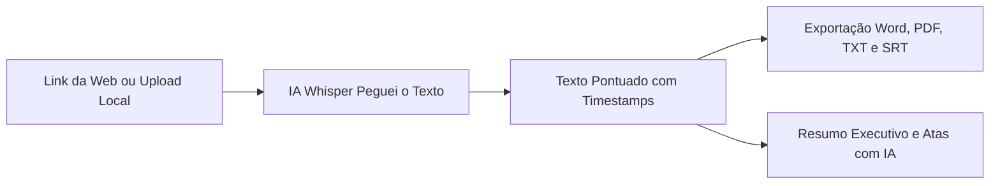

A forma como profissionais, estudantes, advogados e criadores de conteúdo lidam com vídeos e gravações mudou radicalmente. Ninguém mais passa horas com fones de ouvido pausando o reprodutor a cada três segundos para digitar falas manualmente.

Hoje, a rotina de quem busca alta produtividade resume-se a uma ação simples: **colar o link de um vídeo da internet** (como uma aula no YouTube, um corte viral no TikTok ou um Reels no Instagram) ou **fazer o upload de um arquivo de vídeo ou áudio já gravado** (como reuniões gravadas, entrevistas acadêmicas ou mensagens de voz do WhatsApp) e receber o texto integral formatado em segundos.

No entanto, ao pesquisar por *"melhores ferramentas de transcrição de vídeo"*, o usuário quase sempre se depara com comparações confusas que misturam robôs corporativos de reunião, softwares pesados de edição de estúdio e páginas piratas cheias de anúncios.

Para trazer clareza absoluta, preparamos este **comparativo definitivo para 2026**. Selecionamos as **10 principais plataformas do mercado** que atendem estritamente ao caso de uso de **transcrição via link ou upload de arquivo**, avaliadas sob os 5 critérios que realmente definem qual serviço vale o seu tempo e o seu dinheiro.

---

## Os 5 Critérios Decisivos de Avaliação

Para que a comparação seja justa e objetiva, cada ferramenta foi submetida aos seguintes critérios práticos:

1. **Versatilidade de Links Suportados**: A plataforma aceita apenas links do YouTube ou consegue extrair o áudio de **TikTok, Instagram Reels, Facebook, LinkedIn e outras redes** diretamente pela URL?
2. **Compatibilidade de Upload de Arquivos**: O sistema aceita os formatos mais comuns de vídeo (**MP4, MOV, WebM, MKV**) e de áudio (**MP3, WAV, M4A e áudios de WhatsApp .opus**)?
3. **Formatos de Saída e Exportação**: O serviço permite baixar o documento pronto em **Word (.docx)** editável, **PDF** diagramado, **TXT** limpo e legendas sincronizadas **.SRT** com minutagem?
4. **Inteligência Artificial Além da Transcrição (Resumos e Atas)**: A ferramenta apenas digita as palavras soltas ou possui IA generativa para criar **resumos executivos, atas de reunião e tópicos chave** em um clique?
5. **Modelo de Preço (Grátis vs. Pago) e Custo Real**: A plataforma oferece teste gratuito real sem exigir cartão de crédito? Os planos são transparentes em **Reais (BRL)** ou prendem o usuário em assinaturas caras em Dólar/Euro com IOF e renovação automática?

---

## Tabela Comparativa Geral: As 10 Ferramentas Lado a Lado

| Plataforma | 1. Versatilidade de Links | 2. Upload de Arquivos | 3. Formatos de Saída | 4. Resumos e Atas com IA | 5. Custo & Modelo de Preço |
| :--- | :--- | :--- | :--- | :--- | :--- |
| 🚀 **[Peguei o Texto](/)** | ✅ **Máxima**: YouTube, TikTok, Reels, Facebook e +1.700 sites | ✅ **Total**: MP4, MOV, WebM, MKV, MP3, WAV, M4A e WhatsApp (.opus) | ✅ **Completos**: Word (.docx), PDF profissional, TXT e legendas .SRT | ✅ **Sim**: Resumos executivos e atas com IA em 1 clique | 🟢 **Melhor Custo-Benefício**: 5 min grátis sem cartão. Pacotes avulsos a partir de **R$ 4,90** (sem assinatura obrigatória) |
| **Transkriptor** | ⚠️ Regular: YouTube, Google Drive, OneDrive | ✅ Sim: MP4, MP3, WAV, WebM | ✅ Sim: Word, PDF, TXT, SRT | ⚠️ Básico (apenas nos planos mais caros) | 🔴 Caro: Cobra em Dólar (~$9,99 a $14,99/mês = ~R$ 60 a R$ 90/mês + IOF) com renovação automática recorrente |
| **Notta** | ⚠️ Limitado: Apenas links do YouTube | ✅ Sim: MP4, MP3, WAV, AAC | ✅ Sim: Word, PDF, TXT, SRT | ✅ Sim: Gera resumos com IA | 🔴 Caro: Freemium limitado a 3 min por arquivo; planos a partir de ~$13,99/mês (~R$ 80/mês) em Dólar |
| **VEED.io** | ⚠️ Limitado: YouTube e Dropbox | ✅ Sim: MP4, MOV, MP3 | ⚠️ Restrito: TXT e SRT (Word/PDF exigem planos Pro) | ⚠️ Focado em cortes de vídeo, resumos limitados | 🔴 Muito Caro: Grátis corta aos 10 min com marca d'água; plano Pro custa ~$18/mês (~R$ 110/mês) em Dólar |
| **Happy Scribe** | ⚠️ Limitado: YouTube e Vimeo | ✅ Sim: MP4, MOV, MP3, WAV | ✅ Sim: Word, PDF, TXT, SRT | ❌ Não: Apenas transcrição e tradução literal | 🔴 Proibitivo: Cobra por hora em Euro (~€0,20/min = ~R$ 1,25 por minuto de vídeo) |
| **Riverside.fm** | ❌ Não aceita links de redes sociais (só upload) | ✅ Sim: MP4, MOV, MP3, WAV | ⚠️ Limitado: Apenas TXT e SRT | ⚠️ Apenas resumos nos planos de gravação de estúdio | 🟡 Freemium isolado, mas suíte completa custa a partir de $15/mês em Dólar |
| **Flixier** | ⚠️ Regular: YouTube, Drive e Zoom | ✅ Sim: MP4, MOV, MP3 | ⚠️ Limitado: TXT e SRT | ❌ Não gera resumos executivos nem atas | 🔴 Caro: Limite grátis de 10 min de exportação; planos pagos a partir de ~$14/mês em Dólar |
| **Maestra.ai** | ⚠️ Regular: YouTube e Instagram | ✅ Sim: MP4, MOV, MP3, WAV | ✅ Sim: Word, PDF, TXT, SRT | ⚠️ Focado em dublagem e legendagem automática | 🔴 Caro: Teste de apenas 15 min; planos cobrados em Dólar por minuto/mês (~$10 a $29/mês) |
| **Klap / Opus Clip** | ⚠️ Focado em YouTube | ⚠️ Apenas arquivos de vídeo | ❌ Incompleto: Apenas texto dos clipes gerados (sem Word/PDF formatado) | ⚠️ Focado em detectar ganchos virais, não em resumos acadêmicos | 🔴 Caro: Planos voltados a agências a partir de ~$19/mês em Dólar |
| **Recurso Nativo do YouTube** | ❌ Apenas vídeos do próprio YouTube com legenda | ❌ Não aceita upload de arquivos locais | ❌ Fraco: Apenas copiar texto na tela (sem Word, sem PDF, sem SRT) | ❌ Não possui nenhuma IA ou resumo | 🟢 100% Grátis, porém sem pontuação, sem formatação e sem recursos de documento |

---

## Análise Aprofundada das Ferramentas

---

### 1. Peguei o Texto (A Opção Mais Completa e Melhor Custo-Benefício)

O **[Peguei o Texto](/)** foi concebido especificamente para eliminar todas as dores e complexidades enfrentadas pelo usuário brasileiro em ferramentas estrangeiras. Ele combina uma avançada rede neural de reconhecimento de fala (*Whisper otimizado para o português brasileiro*) com modelos de IA generativa para entrega de documentos finais estruturados.

#### Como se comporta nos 5 critérios:
1. **Versatilidade de Links**: É o campeão indiscutível da categoria. Aceita URLs de **YouTube**, **TikTok** (com extração limpa sem marca d'água), **Instagram Reels**, **Facebook**, **LinkedIn** e links diretos da web.
2. **Upload de Arquivos**: Suporta tanto contêineres de vídeo (**MP4, MOV, WebM, MKV**) quanto faixas de áudio (**MP3, WAV, M4A**) e, de forma pioneira, arquivos de áudio do **WhatsApp (.opus)** sem exigir conversão prévia.
3. **Formatos de Saída**: Exporta em **Word (.docx)** pronto para edição, **PDF** profissional, **TXT** limpo e arquivos de legendas sincronizadas **.SRT** com minutagem precisa.
4. **Resumos e Atas com IA**: Em um clique, a IA sintetiza o vídeo, extraindo os tópicos principais, pontos de decisão e resumos executivos prontos para enviar por e-mail ou WhatsApp.
5. **Preço e Custo-Benefício**: 
   * **Gratuito**: Oferece 5 minutos grátis imediatos para qualquer usuário testar sem cadastrar cartão de crédito (+10 minutos por indicação).
   * **Pacotes Avulsos sem Mensalidade**: Diferente dos concorrentes que prendem o usuário em assinaturas recorrentes com pegadinhas, o Peguei o Texto permite comprar pacotes de minutos sob demanda em Reais:
     * **Starter**: R$ 4,90 (60 minutos = R$ 0,08 por minuto).
     * **Pro**: R$ 17,90 (300 minutos = **R$ 0,05 por minuto**, com Word, PDF, SRT e Resumos IA).
     * **Business**: R$ 79,90 (1.000 minutos de transcrição com IA).

---

### 2. Transkriptor

O **Transkriptor** é uma plataforma multinacional com forte investimento em anúncios e SEO no Brasil.

* **Versatilidade de Links**: Aceita links do YouTube, Google Drive e OneDrive. Não possui suporte prático e limpo para TikTok e Instagram Reels.
* **Upload de Arquivos**: Aceita a maioria dos formatos convencionais de áudio e vídeo (MP4, MP3, WAV).
* **Formatos de Saída**: Boa variedade de formatos (Word, PDF, SRT e TXT).
* **Resumos com IA**: Possui assistente de IA, porém os recursos de síntese mais robustos exigem planos corporativos caros.
* **Custo**: Oferece apenas 90 minutos de teste inicial. Seus planos são cobrados em **Dólar americano** (a partir de $9,99/mês = cerca de R$ 60 a R$ 90/mês com IOF do cartão) em formato de assinatura recorrente, gerando frequentes reclamações de cancelamentos difíceis.

---

### 3. Notta

O **Notta** destaca-se pela modernidade de sua interface e sincronização em nuvem.

* **Versatilidade de Links**: Muito limitado para URLs externas, focando praticamente apenas no YouTube.
* **Upload de Arquivos**: Aceita arquivos locais de áudio e vídeo com bom processamento.
* **Formatos de Saída**: Exporta em TXT, DOCX, PDF e SRT.
* **Resumos com IA**: Possui bons modelos de resumo e geração de notas automáticas.
* **Custo**: O plano gratuito é bastante restritivo (limita o áudio a apenas 3 a 5 minutos por arquivo). O plano Pro custa a partir de **$13,99/mês em Dólar** (mais de R$ 80/mês), tornando-se pesado para quem precisa de transcrições esporádicas.

---

### 4. VEED.io

O **VEED.io** é um editor de vídeo completo baseado em navegador com recurso de transcrição integrado.

* **Versatilidade de Links**: Aceita links do YouTube e integração com Dropbox.
* **Upload de Arquivos**: Suporta formatos modernos de vídeo e áudio.
* **Formatos de Saída**: No plano gratuito, exporta apenas legendas básicas ou texto puro. Arquivos estruturados em Word e PDF exigem upgrades pagos.
* **Resumos com IA**: O foco da plataforma é corte e edição de vídeo; os resumos de texto são secundários.
* **Custo**: O plano grátis corta os vídeos aos 10 minutos e insere marcas d'água na exportação visual. O plano básico custa a partir de **$18/mês em Dólar** (~R$ 110/mês).

---

### 5. Happy Scribe

O **Happy Scribe** é uma ferramenta de alta reputação sediada na Europa, muito utilizada por grandes agências de mídia internacional.

* **Versatilidade de Links**: Suporta links de YouTube e Vimeo.
* **Upload de Arquivos**: Excelente compatibilidade com arquivos de estúdio (MP4, MOV, WAV, AIF).
* **Formatos de Saída**: Exportação técnica completa (DOCX, PDF, SRT, VTT, STL).
* **Resumos com IA**: Focado estritamente na transcrição fiel palavra por palavra e tradução; não gera atas executivas automáticas.
* **Custo**: Extremamente elevado para pessoas físicas e pequenas empresas no Brasil. Cobra cerca de **€ 0,20 por minuto** de transcrição automática (mais de R$ 1,20 por minuto!), o que faz uma hora gravada custar mais de R$ 70,00.

---

### 6. Riverside.fm (Ferramenta de Transcrição)

O **Riverside** é uma das maiores plataformas de gravação de podcasts do mundo e oferece uma ferramenta gratuita de transcrição em seu site.

* **Versatilidade de Links**: **Não suporta links de redes sociais** (não transcreve colando URL do YouTube, TikTok ou Reels).
* **Upload de Arquivos**: Funciona exclusivamente via upload de arquivos locais de áudio e vídeo (MP4, MOV, MP3).
* **Formatos de Saída**: Exporta apenas em **TXT** simples e legendas **SRT**. Não gera Word formatado nem PDF.
* **Resumos com IA**: Os resumos inteligentes existem apenas na plataforma completa de estúdio pago.
* **Custo**: A ferramenta isolada é freemium, mas a suíte completa exige planos a partir de **$15/mês em Dólar**.

---

### 7. Flixier

O **Flixier** é conhecido como um editor de vídeo na nuvem de alta velocidade.

* **Versatilidade de Links**: Permite importar URLs do YouTube, Google Drive e Zoom.
* **Upload de Arquivos**: Bom suporte a arquivos de vídeo em MP4 e MOV.
* **Formatos de Saída**: Focado em gerar legendas (.SRT, .VTT) e texto simples.
* **Resumos com IA**: Não possui recursos dedicados para síntese executiva ou extração de tópicos de estudo.
* **Custo**: O plano grátis possui uma cota de exportação de apenas 10 minutos por mês. Os planos pagos iniciam em **$14/mês em Dólar**.

---

### 8. Maestra.ai

O **Maestra.ai** é focado na localização de conteúdo com transcrição, dublagem sintética e legendagem automática.

* **Versatilidade de Links**: Aceita links do YouTube e Instagram.
* **Upload de Arquivos**: Aceita múltiplos formatos de áudio e vídeo.
* **Formatos de Saída**: Suporta DOCX, PDF, TXT e SRT.
* **Resumos com IA**: Recursos voltados principalmente para tradução e legendas multilíngues.
* **Custo**: Disponibiliza apenas 15 minutos gratuitos de teste. Os planos são cobrados por minuto ou por assinaturas em Dólar (a partir de $10 a $29/mês), com custo elevado por volume.

---

### 9. Klap / Opus Clip

O **Opus Clip** e o **Klap** são ferramentas de Inteligência Artificial para criadores que desejam transformar vídeos longos do YouTube em cortes verticais curtos para TikTok e Reels.

* **Versatilidade de Links**: Excelente integração com links de vídeos do YouTube.
* **Upload de Arquivos**: Focado em uploads de arquivos de vídeo MP4 e MOV.
* **Formatos de Saída**: **Inadequado para quem busca documentos de estudo ou trabalho**. Eles entregam o texto fatiado nos clipes de vídeo gerados, sem opção de baixar um Word ou PDF estruturado da íntegra do conteúdo.
* **Resumos com IA**: A IA analisa as falas para encontrar ganchos virais (*hooks*), e não para redigir atas formais.
* **Custo**: Planos pagos a partir de **$19/mês em Dólar**, voltados a agências e produtores de vídeo.

---

### 10. Recurso Nativo do YouTube (Transcrição do Player)

O próprio **YouTube** disponibiliza uma transcrição automática embutida para vídeos que possuem legendas automáticas ativadas pelo criador.

* **Versatilidade de Links**: Funciona **exclusivamente dentro do próprio YouTube**.
* **Upload de Arquivos**: **Não aceita nenhum tipo de upload de arquivos**.
* **Formatos de Saída**: Extremamente limitado. O usuário precisa copiar o texto manualmente na barra lateral do player e colar no bloco de notas. Não exporta em Word, PDF nem SRT.
* **Resumos com IA**: Inexistente. Não gera resumos, não resume tópicos e não separa interlocutores.
* **Custo**: **100% Gratuito**, mas exige horas de trabalho manual posterior para corrigir a falta de pontuação e organizar os parágrafos.

---

## Veredito: Qual Ferramenta Oferece o Melhor Custo-Benefício em 2026?

Ao analisar detalhadamente os 5 critérios que impactam a rotina de quem precisa transcrever mídias na prática, a conclusão é nítida:

1. **A Ferramenta Mais Completa e Acessível: [Peguei o Texto](/)**
   * É a única solução que une **suporte universal a links** (+1.700 sites incluindo TikTok e Reels), **upload de qualquer arquivo** (inclusive áudios de WhatsApp), **exportação completa** (Word, PDF, SRT), **resumos executivos com IA** e cobrança justa em **Reais sem mensalidade obrigatória** (a partir de R$ 4,90).
2. **Para Quem Já Tem Orçamento Corporativo em Dólar**:
   * O **Transkriptor** e o **Notta** são alternativas viáveis caso sua empresa já pague despesas com cartão corporativo internacional em moeda estrangeira e necessite de armazenamento contínuo em nuvem própria.
3. **Para Quem Quer Apenas Legendar Vídeos Verticais**:
   * Ferramentas como **Opus Clip** ou **VEED** atendem bem quando o objetivo final é recortar o próprio vídeo, e não obter um documento de texto para estudo ou trabalho.

---

## Perguntas Frequentes (FAQ)

### 1. Como transcrever um vídeo da internet em menos de 1 minuto?
Basta copiar o link do vídeo no YouTube, TikTok ou Instagram, acessar o [Peguei o Texto](/), colar a URL no campo de busca e clicar em transcrever. A Inteligência Artificial processa o áudio na nuvem e entrega a transcrição pontuada e o resumo em segundos.

### 2. Por que evitar assinar ferramentas em Dólar ou Euro no Brasil?
Além da volatilidade cambial e da cobrança de impostos como o IOF (que encarece a fatura em até 4,38%), muitas plataformas estrangeiras utilizam sistemas de renovação automática agressivos que dificultam o cancelamento. Comprar créditos em Reais via pagamento único no [Peguei o Texto](/precos) garante previsibilidade total de custos.

### 3. É possível transcrever áudios longos do WhatsApp pelo celular?
Sim! No Peguei o Texto, você pode encaminhar ou fazer o upload de arquivos de voz do WhatsApp com a extensão `.opus` diretamente pelo navegador do smartphone, recebendo o texto estruturado em Word ou PDF sem precisar instalar aplicativos pesados.

---

## Conclusão: Pare de Digitar e Multiplique sua Produtividade

A Inteligência Artificial tornou a transcrição manual uma tarefa obsoleta. Ter à disposição uma ferramenta flexível que aceita tanto o link de uma aula na web quanto o arquivo de uma reunião de trabalho economiza dezenas de horas por semana.

Experimente o [Peguei o Texto](/) gratuitamente agora mesmo (com 5 minutos de teste sem cadastro de cartão) e descubra como transformar qualquer vídeo ou áudio em texto e resumos inteligentes com a máxima velocidade do mercado!
