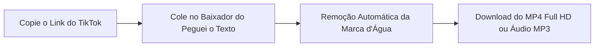
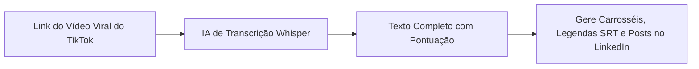

O termo **"TikTok video download"** tornou-se uma das pesquisas mais populares entre criadores de conteúdo, gestores de tráfego, editores e usuários comuns das redes sociais. Com mais de 1 bilhão de usuários ativos, o **TikTok** é o maior laboratório de tendências do planeta, reunindo desde tutoriais práticos e receitas até memes virais e cortes inspiradores de podcasts.

No entanto, quem tenta salvar um vídeo diretamente pelo botão nativo do aplicativo esbarra em uma enorme frustração: **a marca d'água saltitante do TikTok**. Além de cobrir partes essenciais da imagem, essa logo prejudica seriamente o seu alcance caso você queira republicar o material no **Instagram Reels**, no **YouTube Shorts** ou no **Facebook**.

Neste **guia definitivo e atualizado para 2026**, você vai aprender o passo a passo seguro para fazer o **TikTok video download sem marca d'água** em alta definição (**MP4 Full HD**), entender por que republicar com logo destrói o alcance dos seus vídeos e descobrir como os maiores influenciadores utilizam Inteligência Artificial para extrair os roteiros e legendas de vídeos virais em segundos.

---

## O Problema da Marca d'Água: Por Que Você Não Deve Republicar Vídeos com Logo

Quando você clica no botão "Salvar vídeo" dentro do aplicativo do TikTok, a plataforma insere uma marca d'água animada contendo o logotipo da rede e o `@nome_de_usuario`, que fica pulando do canto superior esquerdo para o inferior direito da tela.

Embora isso sirva para divulgar a rede social, para criadores e marcas isso representa um **grave obstáculo**:

1. **Punição Algorítmica da Meta (Instagram e Facebook)**: Em comunicados oficiais sobre as boas práticas do Reels, os engenheiros do Instagram confirmaram que o algoritmo **identifica automaticamente marcas d'água de concorrentes** e reduz a distribuição do vídeo na aba Explorar e nas recomendações de novos seguidores.
2. **Penalização no YouTube Shorts**: O YouTube privilegia conteúdos nativos e limpos. Vídeos verticais contendo marcas de terceiros recebem menor prioridade nos testes de tração do feed de Shorts.
3. **Aparência Pouco Profissional**: Vídeos republicados com marcas d'água passam a impressão de amadorismo, poluem o design visual e cobrem legendas ou textos importantes na tela.

> **Regra de Ouro do Repurposing**: Se você produz vídeos curtos para o TikTok, salve sempre a versão limpa **sem marca d'água** para distribuir com força máxima no Instagram Reels, Shorts, Pinterest e LinkedIn.

---

## Os Perigos dos Conversores Piratas da Web (SnapTik, SSSTik e Clones)

Ao procurar por "TikTok video download" no Google, é comum cair em dezenas de sites clones de ferramentas antigas como SnapTik ou SSSTik. No entanto, essas páginas costumam operar com táticas agressivas:

* **Popups de Notificações Falsas**: Janelas que bloqueiam a tela dizendo *"Clique em Permitir para baixar seu vídeo"*, autorizando o envio de notificações com falsos alertas de vírus e propagandas de apostas.
* **Banners Falsos de Download**: Botões coloridos com textos como *"Download Now"* que na verdade instalam extensões suspeitas no seu navegador.
* **Compressão Excessiva**: Sites de baixa qualidade que convertem o vídeo para resoluções baixas (como 480p), deixando a imagem pixelada e com cores lavadas.

Para garantir sua segurança, utilize sempre plataformas que realizem a extração de forma transparente na nuvem, sem exigir downloads de arquivos `.apk` ou softwares suspeitos.

---

## Método 1: Baixar Vídeos do TikTok Sem Marca d'Água no Peguei o Texto (Recomendado)

A forma mais rápida, segura e livre de anúncios invasivos para baixar vídeos do TikTok em **MP4 Full HD sem marca d'água** é através do [Baixador de Vídeos do TikTok do Peguei o Texto](/baixar-video-tiktok).

Desenvolvido com tecnologia de processamento direto da nuvem (sem intermediários publicitários), o serviço preserva 100% da resolução original do criador e entrega o arquivo limpo em um clique.

### Passo a passo simples:
1. Abra o aplicativo do **TikTok** no seu celular (ou acesse pelo computador).
2. No vídeo que deseja baixar, toque no ícone de **Compartilhar** (setinha ou ícone do WhatsApp no canto direito).
3. Selecione a opção **"Copiar link"**.
4. Acesse o [Baixador de TikTok do Peguei o Texto](/baixar-video-tiktok) no seu navegador.
5. Cole a URL no campo de busca e clique em **"Buscar Vídeo"**.
6. O sistema apresentará o vídeo com a opção **"Baixar Vídeo (MP4 HD)"** (já sem marca d'água) e **"Baixar Áudio (MP3)"**.
7. O download iniciará instantaneamente no seu computador ou smartphone!

---

## Método 2: Como Fazer o TikTok Video Download no Celular (Android e iPhone)

### No Celular Android:
1. Copie o link do vídeo no app do TikTok.
2. Abra o navegador **Chrome** ou **Brave** no Android e acesse `pegueiotexto.com.br/baixar-video-tiktok`.
3. Cole o link e toque em **"Baixar Vídeo (MP4 HD)"**.
4. O arquivo será salvo diretamente na sua pasta **Downloads** e aparecerá automaticamente na **Galeria** do celular ou no app **Google Fotos**, pronto para ser editado no CapCut ou postado no Instagram Reels.

### No iPhone e iPad (iOS):
O navegador **Safari** no iOS conta com um gerenciador nativo de downloads excelente:
1. Abra o TikTok, toque em **Compartilhar** > **Copiar link**.
2. Abra o **Safari** e entre no [Baixador do Peguei o Texto](/baixar-video-tiktok).
3. Cole a URL e clique em **"Baixar Vídeo (MP4 HD)"**.
4. O Safari exibirá uma janela de confirmação: toque em **"Baixar"**.
5. Um ícone azul de download aparecerá ao lado da barra de endereços. Toque nele, abra o vídeo baixado, clique no botão de **Compartilhar** (quadrado com setinha para cima) e escolha **"Salvar Vídeo"**.
6. O vídeo limpo sem logo será transferido imediatamente para o rolo da câmera do app **Fotos** do iPhone!

---

## Método 3: Como Baixar no Computador (PC e Mac)

Se você trabalha como editor de vídeo, social media ou gestor de tráfego e utiliza programas como Premiere Pro, DaVinci Resolve ou CapCut para Desktop:

1. Acesse o site do [TikTok](https://www.tiktok.com) no navegador do seu computador.
2. Abra o vídeo desejado e copie a URL que aparece na barra de endereços (ex: `https://www.tiktok.com/@perfil/video/123456789...`) ou clique no botão de compartilhar.
3. Abra a ferramenta de [Download do TikTok](/baixar-video-tiktok).
4. Cole o endereço e clique em **"Buscar Vídeo"**.
5. Clique em **"Baixar Vídeo (MP4 HD)"** para salvar o arquivo `.mp4` diretamente na pasta do seu computador em velocidade máxima.

---

## Método 4: Baixar Apenas o Áudio do TikTok em MP3

Muitas vezes, a sua intenção ao baixar um vídeo do TikTok não é a imagem, mas sim a **música viral de fundo**, a voz do narrador ou um efeito sonoro cômico para usar na sua própria edição.

No [Peguei o Texto](/baixar-video-tiktok), basta colar o link do vídeo e clicar no botão **"Baixar Áudio (MP3)"**. O sistema extrai a faixa de som pura, permitindo que você a salve como arquivo sonoro independente. 

*(Se você também gosta de baixar trilhas e canções completas, veja nosso tutorial especial sobre [como baixar músicas do YouTube em MP3](/blog/baixar-musicas-do-youtube)).*

---

## O Segredo dos Criadores de Alta Performance: Transcrever o Roteiro do TikTok com IA

Baixar o vídeo é apenas o primeiro passo. Criadores que faturam alto e ganham milhões de visualizações sabem que o maior valor de um vídeo viral está no seu **roteiro**:

* **O Gancho Inicial (*The Hook*)**: Quais foram as primeiras palavras ditas nos primeiros 3 segundos para reter a atenção?
* **A Estrutura de Retenção**: Como o criador conduziu a história até o clímax?
* **A Chamada para Ação (*Call to Action*)**: Como ele estimulou comentários e compartilhamentos?

Em vez de perder horas assistindo ao vídeo, pausando a cada frase para tentar digitar o que foi falado no bloco de notas, você pode utilizar a ferramenta de [Transcrever Vídeo do TikTok](/transcrever-tiktok) do Peguei o Texto:

### Vantagens de Transcrever TikToks com IA:
1. **Roteiro Pronto em 10 Segundos**: Receba todo o texto falado do vídeo perfeitamente pontuado e dividido em parágrafos.
2. **Reaproveitamento Multiplataforma**: Transforme a explicação do TikTok em uma thread para o X (Twitter), um artigo de blog ou um post educativo para o Instagram.
3. **Criação de Legendas `.SRT`**: Se você for legendar vídeos no CapCut, exporte o arquivo de legendas sincronizadas em `.srt` (confira nosso guia de [como gerar legendas SRT para vídeos do YouTube e TikTok](/blog/como-gerar-legendas-srt-para-videos-do-youtube-e-tiktok)).

---

## Tabela Comparativa: As Melhores Ferramentas para Baixar Vídeos do TikTok

| Ferramenta | Sem Marca d'Água? | Qualidade Máxima | Popups Invasivos? | Extrai Áudio MP3? | Transcreve com IA? |
| :--- | :--- | :--- | :--- | :--- | :--- |
| 🚀 **[Peguei o Texto](/baixar-video-tiktok)** | **Sim (100% Limpo)** | **MP4 Full HD** | **Não (Zero Vírus)** | **Sim (1 Clique)** | **Sim (Whisper IA)** |
| 📱 **App Oficial do TikTok** | Não (Vem com logo) | HD Original | Não | Não | Não |
| 🌐 **SnapTik / SSSTik** | Sim | Geralmente 720p | Sim (Muitos anúncios) | Limitado | Não |
| 🤖 **Bots do Telegram** | Sim | Variável | Risco de privacidade | Sim | Não |

---

## Aspectos Legais e Boas Práticas ao Salvar Vídeos do TikTok

* **Para Seus Próprios Vídeos**: Você tem total liberdade de baixar seus próprios vídeos sem marca d'água para publicá-los no Instagram Reels, Shorts e Kwai. Essa é a prática mais recomendada pelo mercado de marketing digital.
* **Para Conteúdos de Terceiros**: Se for utilizar trechos de vídeos de outros criadores para comentários, análises ou reações (*fair use*), cite sempre o autor original nos créditos da publicação. Nunca republique conteúdos protegidos na íntegra fingindo ser de sua autoria.

---

## Perguntas Frequentes (FAQ)

### 1. O download sem marca d'água reduz a qualidade do vídeo?
Não. Ferramentas modernas como o [Peguei o Texto](/baixar-video-tiktok) acessam o fluxo de vídeo original armazenado nos servidores do TikTok antes da renderização da marca d'água, entregando exatamente a mesma resolução e nitidez em que o vídeo foi gravado.

### 2. A ferramenta funciona com links curtos do tipo `vm.tiktok.com` ou `vt.tiktok.com`?
Sim! O sistema resolve automaticamente os redirecionamentos de links gerados pelo botão de compartilhamento do aplicativo móvel, identificando o vídeo sem erros.

### 3. É possível baixar vídeos de contas privadas do TikTok?
Não. Por questões de privacidade e segurança dos usuários, nenhuma ferramenta segura consegue acessar mídias postadas em contas privadas que exigem autorização de seguidor.

### 4. Preciso instalar algum aplicativo ou extensão no meu celular?
Não. O [Baixador do Peguei o Texto](/baixar-video-tiktok) funciona 100% online através de qualquer navegador web (Chrome, Safari, Edge, Firefox), sem ocupar espaço na memória com instaladores suspeitos.

---

## Conclusão: Baixe Vídeos Limpos e Potencialize seu Alcance

O processo de **TikTok video download** não precisa ser uma experiência repleta de anúncios abusivos e marcas d'água indesejadas. Com ferramentas limpas e seguras como o [Peguei o Texto](/baixar-video-tiktok), você salva seus vídeos prediletos em MP4 Full HD e extrai áudios em MP3 com rapidez e tranquilidade.

E se o seu objetivo for crescer nas redes sociais com conteúdos que engajam, dê um salto na sua estratégia: transforme os vídeos virais da sua área em **roteiros estruturados e legendas profissionais com IA**.

Acesse o [Transcritor de TikTok do Peguei o Texto](/transcrever-tiktok) agora mesmo e descubra o poder de converter vídeos em texto em segundos!
